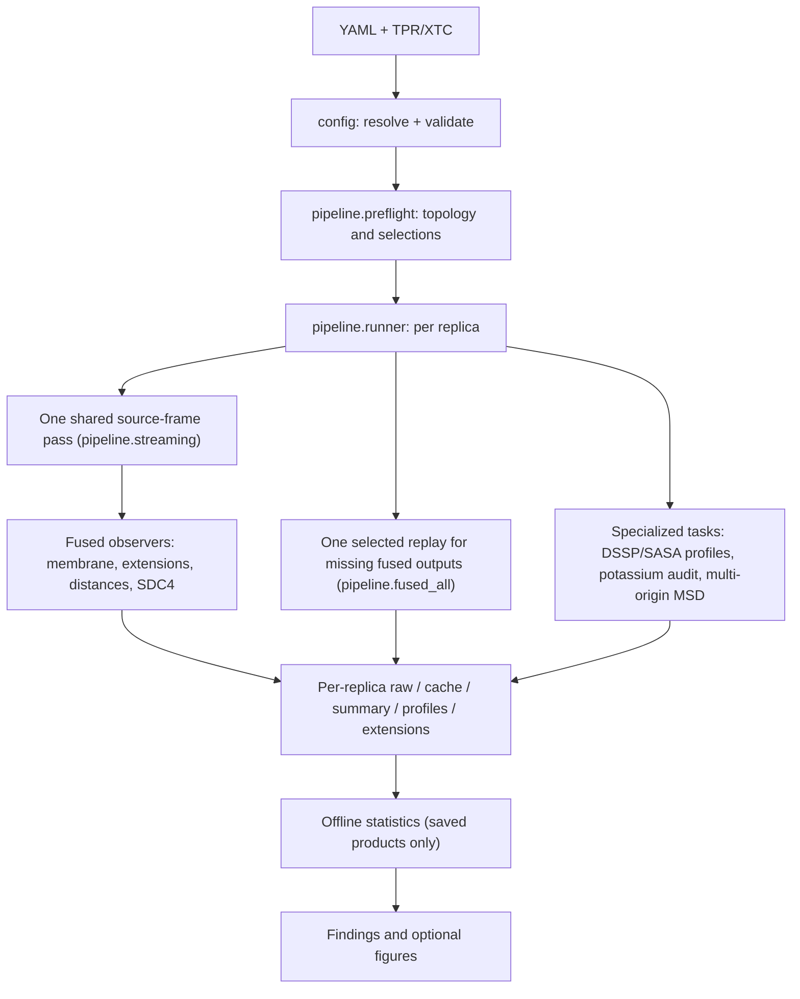
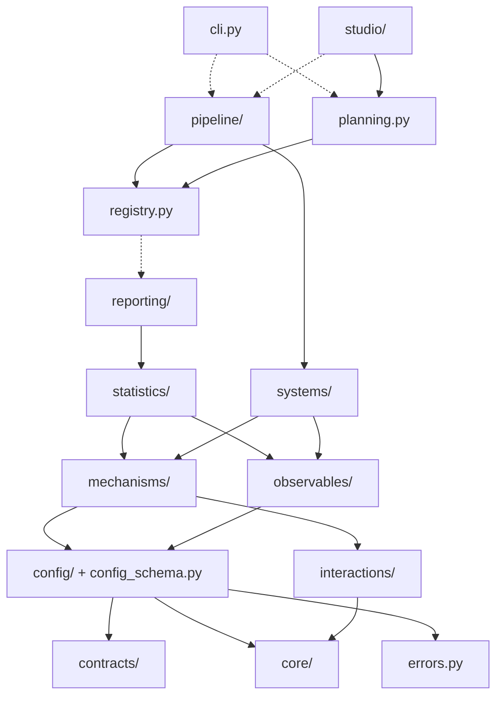

# Architecture

How `src/mdscope/` is organized, why, and where each decision lives. Design criteria and the rejected alternatives are recorded in [ADR-0002](adr/0002-evidence-first-architecture.md); control-flow diagrams are in [Pipeline graphs](pipeline-graphs.md). **Internal module aliases are not retained**: CLI commands, YAML keys, `mdscope plan --format json` and persisted outputs are the public contracts.

## Data flow



Trajectories are read only inside `pipeline/` and by the specialized tasks it schedules. Statistics, reporting, planning and Studio work from YAML and saved products and never open an XTC. Membrane observers consume **source coordinates before protein fitting**; never rotate or recenter the shared frames ([Scientific contracts](scientific-contracts.md)).

## Packages and dependency direction

Packages are grouped by role. Lower layers never import higher ones; `tests/test_import_layering.py` enforces this, including function-level imports.

```text
contracts/      dependency-free: output descriptors, statistics/figure family lists, option schemas
config/         YAML loading, defaults, named runs, enabled-analysis predicates, ordered validators
core/           geometry/PBC, selections, sequence and glycan identity, persistence, checkpoints
observables/    physical measurements (structure, membrane, lipid, SASA, DSSP, MSD, density, hydration)
interactions/   chemically distinct contact detectors (H bonds, salt bridges, ligand/lipid contacts)
mechanisms/     generic derived mechanisms (local environment, motif residence, occlusion, states)
systems/sdc4/   SDC4-specific geometry, HS mechanisms and potassium-bridge audit
statistics/     replica-aware inference from saved products
reporting/      findings, tables and figures from saved results
pipeline/       when and how analyses run: streaming, replay, tasks, restart, finalization
cli.py, studio/ user entry points; planning.py, registry.py, config_schema.py are read-only views
```

Allowed direction: `contracts` ← `config`/`core` ← `observables`/`interactions` ← `mechanisms` ← `systems` ← `statistics`/`reporting` ← `pipeline` ← `cli`/`studio`. `contracts/` imports nothing from `mdscope`, which keeps planning, validation and Studio import-light; `config/` may import only `core` and `contracts`. Generic sampled contact episodes live in `core/residence.py`, below both solvation and motif residence.

The diagram below is generated from the source, so it cannot drift: an arrow means the upper unit imports the lower one (dashed: only inside functions), and an import already implied by a longer path is not drawn. `tests/test_architecture_map.py` fails when it is stale; regenerate it with `python scripts/architecture_map.py --write-docs`.

<!-- BEGIN GENERATED package dependencies; regenerate with: python scripts/architecture_map.py --write-docs -->


- `config/ + config_schema.py` import each other and are drawn as one node.
<!-- END GENERATED package dependencies -->

**Why this layout and not another** ([ADR-0002](adr/0002-evidence-first-architecture.md)):

- **Role packages, not one folder per analysis.** A scientific analysis legitimately has several owners (YAML, kernel, output contract, scheduling, statistics, figures) that change for different reasons. The goal is that each *fact* has one owner, not that each analysis has one folder. A mandatory `analyses/`, `engine/`, `interfaces/` migration was evaluated and rejected: it moved files without reducing the number of edits a new analysis needs.
- **Cohesion over small files.** Modules are split where ownership, dependencies or change lifecycles differ, never to reduce line counts. The large SDC4 observer, `reporting/plotting.py` and `mechanisms/state_outcomes.py` were reviewed and kept whole: no independently changing seam was found.
- **System-specific science sits above generic science.** `systems/sdc4/` configures and extends generic analyses; it does not import `pipeline/`. A new system adds a `systems/<name>/` entry instead of editing shared kernels.
- **Measurement is separate from scheduling.** `observables/`, `interactions/`, `mechanisms/` and `systems/` define *what* is computed; `pipeline/` decides *when*, and owns trajectory traversal, checkpoints and recovery.

## One owner per fact

| Fact | Owner | Consumers |
|---|---|---|
| YAML defaults, named runs, group-filter and multi-run capabilities (`GROUP_ANALYSES`, `MULTI_RUN_ANALYSES`) | `config/defaults.py` | validators, option schema, streaming, planning, Studio |
| Whether an analysis or family is enabled | `config/runs.py` | registry, pipeline, `systems/sdc4` |
| Validation order and messages | `config/validation.py` dispatching to `config/validators/` | `mdscope validate`, Studio |
| Editor option schema | `config_schema.py` | Studio, unknown-key validation |
| Persisted paths, companions, column/array schemas, producer constants | `contracts/outputs.py` | producers, registry, persisted-input checks |
| Configuration-dependent outputs and required companions | `registry.py` (`analysis_output_plan`, `fused_output_plan`, `saved_output_plan`, `required_artifacts`) | runner, planning, Studio |
| Statistics families → output folders; figure families | `contracts/statistics.STATISTICS_FAMILIES`, `contracts/plot_validation.FIGURE_FAMILIES` | YAML validation, `statistics/dispatch.py`, planning |
| Saved statistics catalog and analysis display metadata | `contracts/statistics.py` (statistics metadata), `planning.py` (`ANALYSIS_METADATA`, `authoring_catalog`) | `mdscope plan`, Studio |
| Figure IDs and renderer destinations | `reporting/plot_ids.py` | plotting, inventory, planning |
| Validity of existing outputs (schema, time grid, provenance) | `pipeline/persisted_inputs.py` | runner, Studio, finalization |
| Atomic writes, archiving, checkpoint inventory | `core/persistence.py`, `core/checkpoints.py` | all producers (kernels never write files directly) |
| Covalent glycan chains; sequence motifs | `core/glycans.py`; `core/motifs.py` + `core/sequence.py` | HS/SDC4, hydration, solvation, K-bridge audit, Studio |

Tests pin the single-owner rules that have regressed before: every statistics and figure family is configurable and catalogued, the group-filter and named-run capability sets match the schema, and analysis metadata names only contract-owned families.

Static statistics schemas, identities, estimator capabilities and candidate filenames live together in `contracts/statistics.py`; planning and runtime selection consume that owner directly.

## Replica execution and recovery

`pipeline/runner.run_replicate` makes one registry-derived decision per replica:

1. **Preflight** validates every existing output and companion (`persisted_inputs`); an invalid committed product fails before anything is rewritten.
2. **Primary stream** (`streaming.run_streaming_pass`) runs when core per-frame products are missing. It drives core measurements and every enabled fused observer from the same frames, with chunked, checkpointed commits.
3. **Fused replay** (`fused_all.run_fused_only`) recomputes exactly the pending `(analysis, run ID)` outputs in **one** source-frame pass, whatever families they belong to. Completed siblings are never recomputed or rewritten. This is the only fused replay loop.
4. **Specialized tasks** (`replica_tasks.specialized_tasks`) run work that cannot share the stream (DSSP/SASA profiles, potassium-bridge audit). Each `AnalysisTask` declares the registered outputs it `produces` and runs only when one of them is absent, the same readiness rule as fused outputs; a missing marker alone does not force recomputation.
5. **Summary** consolidates saved chunks; `finalize_project` runs statistics from saved products.

The primary stream and fused replay close their readers; MDAnalysis keeps Universes reachable, and an open reader locks the file on Windows. Measured on real data, deleting three products from a completed project and resuming decodes 44 frames in one pass instead of 126 frames in four passes, with identical outputs ([#279](https://github.com/MarionQL/MDscope/issues/279)).

## Adding an analysis

A **source-frame scalar** (shaped like `radius_of_gyration`):

1. Default and enabled flag in `config/defaults.py`; a validator in `config/validators/` only if it has parameters.
2. The kernel in the package that matches its science (`observables/`, `interactions/`, …), free of file I/O.
3. Bind it to the shared pass in `pipeline/streaming.py`.
4. Declare its saved identity, units and summary storage in `registry.py` / `contracts/outputs.py`.
5. Add display metadata to `planning.ANALYSIS_METADATA`. Generic time-series statistics and plots then pick up the new column; custom statistics or figures are optional extensions.

A **named-run profile** (shaped like `residue_membrane_distance`) additionally needs `MULTI_RUN_ANALYSES`, option schema and validator entries, a fused observer in `pipeline/fused_*.py`, a descriptor with companions in `contracts/outputs.py`, and run-scoped figure patterns. Test with two configured runs and one disabled run: exact run IDs and paths, no output for the disabled run, and replay of only the missing run after deleting one.

No step should require copying a list that another module already owns; if it does, move the fact to its owner instead.

## Files and lifecycle

| `project.output` path | Purpose | Keep? |
|---|---|---|
| `resolved_config.yaml`, `run_metadata.json` | Reproducibility and provenance | Yes |
| `.state/rep-*.json` | Completion markers and required-artifact inventory | While restarting |
| `<system>/<replicate>/raw/` | Chunked primary frame series and events | Until finalized |
| `<system>/<replicate>/cache/` | Stream checkpoint, fused chunks, optional aligned arrays | **Keep for restart** |
| `<system>/<replicate>/summary/` | Consolidated scalar series, diffusion, per-replica statistics | Scientific output |
| `<system>/<replicate>/profiles/` | SASA, DSSP, density, RMSF, membrane order, residue distances | Scientific output |
| `<system>/<replicate>/interactions/` | Events, occupancy, lifetimes, presence | Scientific output |
| `<system>/<replicate>/extensions/` | Lipid, HS, solvation, SDC4 and K⁺ measurements | Scientific output |
| `project_summary/statistics/` | Comparisons, uncertainty, coverage, manifest | Regenerable from valid replicas |
| `project_summary/shared_states/` | State model, assignments, populations | Derived output |
| `project_summary/figures/` | Presentation | Regenerable |
| `.archives/` | Previous numerical products moved aside on rerun | Audit for storage |

A file's existence or a completion marker is not proof of validity: `registry.required_artifacts` names the companions and `persisted_inputs` checks identity, schema and sampling. Relative paths written into saved tables and manifests always use `/`, on every OS.

## Statistics

All inference reads saved replica products. Replicas, not frames, are the independent units. `statistics/__init__.py` imports nothing heavy; `statistics/dispatch.py` owns project inference and imports estimators only when a family runs. `statistics/manifest.py` is the read-only manifest reader: planning, plotting and findings require an explicitly `complete` manifest.

| Family | Input | Output folder |
|---|---|---|
| `time_series` | Scalar and group series (plus the optional `matched_time_series` window) | `statistics/time_series/` |
| `profiles` | RMSF, density, DSSP/SASA, residue distances, lipid order, occlusion | `statistics/profiles/` |
| `interactions` | Saved presence, events, lifetimes | `statistics/interactions/` |
| `solvation_rdfs` | RDF curves and shell integrals | `statistics/solvation/` |
| `diffusion` | Multi-origin curves refitted on common lags | `statistics/diffusion/` |
| `coupling` | Matched-grid replicate correlations | `statistics/coupling/` |
| `lipid_contacts` | Lipid contact matrices | `statistics/lipid_contacts/` |

Contrast coverage is written to `statistics/coverage/contrast_coverage.parquet`. `statistics/common.py` holds the shared inference primitives; `statistics/shared_states.py` fits one state model across replicas from saved features. Estimator assumptions: [Scientific contracts](scientific-contracts.md).

## Reporting and Studio

- `reporting/` renders saved results only. `table_reports` owns `statistics_tables.pdf` and its manifest; `record_generated_figures` alone writes `figure_provenance.json`; `figure_inventory` lists published figures and marks legacy PDFs without publication identity as unverified. Panels of the same observable share axis limits via `reporting.shared_scales`.
- Studio authors YAML and never runs trajectories, inference or production rendering. `studio.model` owns the detached draft, group/run edits and export reconciliation; `studio.app` renders widgets; figure candidates come from `planning.authoring_catalog`, topology checks from `pipeline.preflight`, and saved-output checks from `pipeline.persisted_inputs`. User guide: [Studio](../studio.md).

## Change map

| Editing | Check together | Target tests |
|---|---|---|
| Scalar/profile observable | Kernel, streaming binding, registry, summary, statistics family | `test_streaming_smoke.py`, `test_statistics_modes.py`, the numerical oracle |
| Contacts/chemistry | Detector, interaction tables, identity fields, statistics | `test_interaction_statistics_reference.py` |
| HS, lipid, solvation or SDC4 | Mechanism/observable, selections, YAML, companion plan | `test_sdc4_geometry_references.py`, `test_solvation.py`, `test_scientific_reference_oracles.py` |
| Statistical estimator | Family, common kernels, coverage | `test_publication_references.py`, `test_statistics_controls.py` |
| Restart and completeness | Checkpoints, runner, registry, persistence | `test_checkpoint_integrity.py`, `test_mixed_observer_restart.py`, `test_issue128_restart_artifact_contract.py` |
| Figures, CLI, packaging | Reporting or CLI, scripts | `test_report.py`, `test_cli_end_to_end.py`, `test_package_contract.py` |

Which checks a change needs before merge: [Check policy](check-policy.md).

## Inspecting the code graph

```bash
python scripts/architecture_map.py --output /tmp/mdscope-architecture   # modules, imports, calls, cycles
python scripts/architecture_map.py --write-docs                         # regenerate the package diagram above
```

`architecture.json` records the source revision, module imports (including deferred ones), statically resolved calls and multi-module import cycles; CI publishes it as the `mdscope-architecture-map` artifact. The current map has no import cycles. Edges are *possible* dependencies, not observed execution; do not gate CI on edge or module counts.

## Memory and integrity reuse

Shared persistence streams saved Parquet chunks in record batches and publishes
NPZ archives atomically. Fused H-bond tabulation operates one committed chunk at
a time. Large individual order profiles use disk-backed staging; ordinary
profiles retain the existing batched fast path. Derived scientific aggregations
may still materialize their required tables; this does not claim constant memory
for every postprocessor.

Interaction bootstrap weights retain the eight-key eviction and RNG schedule.
The in-memory cache has a 128 MiB budget; additional arrays use unnamed disk-backed
mappings. Reductions operate in batches rather than converting an entire mapped
weight matrix into floating-point temporaries.

Replica preflight and the final audit share successful integrity scans only
within that invocation, while device/inode, size, modification and change times
remain identical. Changed files are rescanned; missing products and schema/time
checks still fail before completion is recorded. No integrity cache survives a
run or replaces scientific validation.
