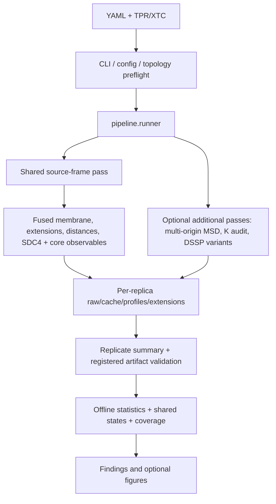

# Architecture

MDscope uses a `src/mdscope/` package. [Package map](../../src/mdscope/README.md) lists ownership; [Contributing](contributing.md) defines refactoring rules. **Internal module aliases are not retained**; CLI/YAML/output compatibility is a separate contract.

## Execution flow

**Not every configuration is single-pass.** Membrane observables consume original source coordinates before protein fitting; optional `msd_trajectory` is synchronized separately.

| Command | Effect |
|---|---|
| `mdscope init --output X.yaml` | Create starter configuration |
| `mdscope validate X.yaml` | Check configuration and topology selections; no numerical results |
| `mdscope replicate X.yaml --index N` | One indexed replica; no project statistics |
| `mdscope run X.yaml` | All replicas and numerical finalization |
| `mdscope statistics X.yaml` / `mdscope finalize X.yaml` | Recompute project statistics from saved replica products |
| `mdscope plotting X.yaml` | Optional saved-data figures |
| `mdscope report STATISTICS_DIR` | Regenerate findings from a completed statistics export |

Key interfaces: `cli.py`, `config.py` (`analysis_runs`, `iter_replicates`), `registry.py` (`analysis_output_plan`, `required_artifacts`), `pipeline/runner.py`, `pipeline/streaming.py`.

## Files and lifecycle

| `project.output` path | Purpose | Keep? |
|---|---|---|
| `resolved_config.yaml`, `run_metadata.json` | Reproducibility/provenance | Yes |
| `.state/rep-*.json` | Completion and required artifact inventory | Yes while restarting |
| `<system>/<replicate>/raw/` | Chunked primary frame series/events | Until safely finalized/reusable |
| `<system>/<replicate>/cache/` | Stream checkpoints, fused chunks, optional aligned arrays | **Keep for restart** |
| `<system>/<replicate>/summary/` | Consolidated scalar series, diffusion, per-replica statistics | Scientific output |
| `<system>/<replicate>/profiles/` | SASA, DSSP, density, RMSF, membrane order, residue distances | Scientific output |
| `<system>/<replicate>/interactions/` | Events, occupancy, lifetime, presence | Scientific output |
| `<system>/<replicate>/extensions/` | Lipid/HS/solvation/SDC4/K measurements | Scientific output |
| `project_summary/statistics/` | Comparisons, uncertainty, coverage, complete manifest | Regenerable from valid replica products |
| `project_summary/shared_states/` | Model, assignments and populations | Derived scientific output |
| `project_summary/figures/` | Diagnostic presentation | Regenerable |
| `.archives/` | Previous numerical products moved on rerun | Audit periodically for storage cost |

**Completeness:** file existence or a completion marker alone is insufficient. `registry.required_artifacts` defines companions; runner/checkpoint validation checks identity, structure, sampling and safe replay. Avoid hash-based gating of compatible historical outputs. Do not delete restart chunks or replace observable formats as part of unrelated cleanup.

## Statistics inputs and outputs

All inference reads **saved** replica products. The manifest records methods, enabled families and completion; source-file snapshots detect input changes during finalization.

| Family | Input | Main output folder |
|---|---|---|
| `time_series` | Scalar/group series; selected solvation/lipid/bridge metrics | `statistics/time_series/` |
| `profiles` | RMSF, density, DSSP/SASA, residue distances, lipid order, occlusion | `statistics/profiles/` |
| `interactions` | Saved presence/events/lifetimes | `statistics/interactions/` |
| `solvation_rdfs` | RDF curves and shell integrals | `statistics/solvation/` |
| `diffusion` | Multi-origin curves refitted on common lags | `statistics/diffusion/` |
| `coupling` | Matched-grid replicate correlations | `statistics/coupling/` |
| `matched_time_series` | Optional second scalar window | `statistics/matched_time_series/` |
| `coverage` | Family-level comparisons | `statistics/coverage/contrast_coverage.parquet` |

- `statistics/common.py`: autocorrelation, block bootstrap, replicate hierarchy, paired/unpaired contrasts, permutation and FDR.
- `statistics/replicate_contrasts.py`: replica-level RDF-shell/diffusion/coupling contrasts; do **not** replace with frame-level resampling.
- `mechanisms/shared_states.py`: shared state fit/populations; not every conditioned table enters the central seven-family coverage audit.
- A 3+3 exact unpaired two-sided test has minimum p = 0.10; pointwise RDF mean/SD is **descriptive**, not a CI. See [Scientific contracts](scientific-contracts.md).

## Change map

| Editing | Check these together | Target tests |
|---|---|---|
| Scalar/profile observable | Observer, registry, summary collector, statistics family | `test_streaming_smoke.py`, `test_statistics_modes.py`, relevant numerical oracle |
| Contacts/chemical entities | Detector, interaction tables, identity fields, statistics | `test_interaction_statistics_reference.py`, contact/chemical tests |
| HS, lipid, solvation or SDC4 | Mechanism/observable, selections, YAML, companion output plan | `test_sdc4_geometry_references.py`, `test_solvation.py`, `test_scientific_reference_oracles.py` |
| Statistical estimator | Family and common kernels, coverage | `test_publication_references.py`, `test_statistics_controls.py` |
| Resume/output completeness | Checkpoints, runner, registry, persistence | `test_checkpoint_integrity.py`, `test_mixed_observer_restart.py`, `test_issue128_restart_artifact_contract.py` |
| Figures/CLI/packaging | Reporting or CLI and scripts, no unneeded science changes | `test_report.py`, `test_cli_end_to_end.py`, `test_package_contract.py` |

CI: Python 3.11/3.13, wheel/sdist from outside checkout, applicable real-trajectory smoke/physics checks. Document tests **actually run**. A synthetic or release smoke pass does not establish six-replica convergence.

## Planned: discover differences without reprocessing XTC

**Proposal, not implemented:** a read-only catalog layered over existing Parquet/NPZ products.

| View | One row per |
|---|---|
| `observable_catalog` | Identity/selection/units, source, availability, supported estimator |
| `estimates` | Replica or system estimate with status, CI and provenance |
| `comparisons` | Condition pair, system-2-minus-system-1 effect, CI, p/q and coverage |
| `discovery` | Physically meaningful region/family effect, support, exploratory rank |
| `coverage` | Every enabled output: tested, descriptive, excluded or unavailable **with reason** |

Approach:
1. Inventory configured and saved observables **before** expensive CI work; preserve species, chain, residue *topology index*, units, leaflet and normalization.
2. Screen candidate differences and replica consistency cheaply; group ordered profiles into meaningful regions.
3. Run expensive per-coordinate inference on supported/preregistered priorities; mark others `not_ci_evaluated`, **not** nonsignificant.
4. Treat selected-on-same-data intervals as exploratory unless independently confirmed or appropriately calibrated. Six independent simulations do not support high-capacity supervised feature discovery.

**No database or rewrite of existing scientific files.** Different observables (RDF shape, occupancy, residence, SASA burial, diffusion, state populations) retain different estimands.

[Workflows](../workflows.md) · [Configuration](../configuration.md) · [Validation gaps](validation-gaps.md)
