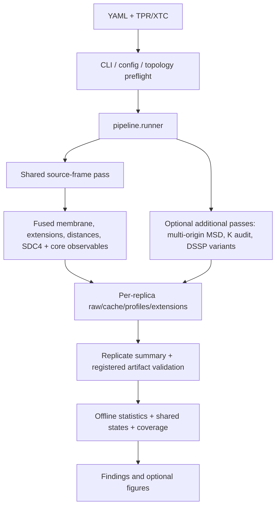

# Architecture

MDscope uses a `src/mdscope/` package. [Package map](../../src/mdscope/README.md) lists ownership; [Contributing](contributing.md) defines refactoring rules. **Internal module aliases are not retained**; CLI/YAML/output compatibility is a separate contract. This page describes the **current** layout; the current criteria-led architecture direction is in [ADR-0002](adr/0002-evidence-first-architecture.md); [ADR-0001](adr/0001-target-package-architecture.md) is the historical fixed-layout proposal.

## Execution flow



**Not every configuration is single-pass.** Membrane observables consume original source coordinates before protein fitting; optional `msd_trajectory` is synchronized separately.

| Command | Effect |
|---|---|
| `mdscope init --output X.yaml` | Create starter configuration |
| `mdscope validate X.yaml` | Check configuration and topology selections; no numerical results |
| `mdscope replicate X.yaml --index N` | One indexed replica; no project statistics |
| `mdscope run X.yaml` | All replicas and numerical finalization |
| `mdscope statistics X.yaml` / `mdscope finalize X.yaml` | Recompute project statistics from saved replica products |
| `mdscope plotting X.yaml` | Optional saved-data figures |
| `mdscope report STATISTICS_DIR` | Regenerate findings from a completed statistics export |

Read-only `cli.py` commands import the runner, statistical estimators, and topology preflight only when their selected command requires them. The statistics package initializer is lightweight; `statistics/dispatch.py` owns project inference and imports estimators only when explicitly invoked. Other lightweight runtime selectors live in `statistics/{contracts,families,manifest,selection,permutation_resolution}.py`; their shared validation rules live in `contracts/{plot_validation,metric_selection,state_feature_spec}.py`. `statistics/families.py` owns the lightweight family identifier list consumed by planning and the statistics dispatcher.

Key interfaces: `cli.py`, `config/` (`defaults.py`, `runs.py`, `validation.py` dispatcher, `validators/` domain checks, YAML loading in `__init__.py`), `registry.py` (`analysis_output_plan`, `required_artifacts`), `contracts/outputs.py` (one descriptor per analysis: primary path, named-run support, companions, schema; producer column/path constants), `output_paths.py` (compatibility exports for persisted paths), `config/runs.py` (shared enabled-analysis predicates), `pipeline/replica_tasks.py` (`specialized_tasks`, `additional_time_series`), `pipeline/runner.py`, `pipeline/streaming.py`.

Output contracts now have a dependency-free owner in `contracts/outputs.py`.
`registry.py` resolves configuration-dependent companions (SASA variants,
solvation options, HS sugar hydration) from those descriptors without importing
observer implementations. Static solvation/hydration column contracts and HS
output paths are imported by producers, rather than rediscovered from producer
classes during planning. Execution scheduling remains in
`config/runs.py`; its enabled predicates are not duplicated
in output descriptors. This is the #260 contract boundary. Under #279 the runner derives one pending
output set from the registry and uses one selected source-frame replay for
compatible missing families, leaving specialized work and SDC4 occlusion
completion separate. See [pipeline graphs](pipeline-graphs.md).


For **execution**, **recovery** and **module-dependency** diagrams, including reproducible SVG/DOT generation, see [Pipeline graphs](pipeline-graphs.md). Import edges are AST-derived; execution and recovery are documented control-flow maps.

## Inspect the current module and call graph

Run from a checkout with Python 3.11+ (and optionally an installed `mdscope`
distribution):

```bash
python scripts/architecture_map.py --output /tmp/mdscope-architecture
# Optional: Graphviz turns DOT graphs into browsable SVGs:
dot -Tsvg /tmp/mdscope-architecture/modules.dot -o /tmp/mdscope-architecture/modules.svg
dot -Tsvg /tmp/mdscope-architecture/calls.dot -o /tmp/mdscope-architecture/calls.svg
```

`architecture.json` contains sorted module dependencies, statically resolved
function calls, multi-module strongly connected components (SCCs), source
revision, Python version, platform and installed distribution version.
The corresponding `modules.dot` and `calls.dot` are generated from
**the current `src/mdscope/` tree**. The CI checks also publish these
files as an `mdscope-architecture-map` artifact. Do not review the old
`analysis/` pyan3 graph as though it represented the current package.

**Static limitations:** imports within conditionals/functions count as
*possible* dependencies, not observed execution; calls are only recognized
when they resolve to a known function or direct method. Decorators, callbacks,
dynamic imports, aliased attributes and reexports can be missed or misleading.
SCCs flag places to inspect; they do **not** prove a runtime circular-import
failure. No trajectory, checkpoint or scientific calculation is executed.

### Static import-cycle review

The original #180 inventory found two deferred import cycles. The
lipid-enrichment runner back-edge was removed first. The solvation cycle was
then removed by making `observables.solvation_common` the single owner of
`rdf_from_counts` and `EPISODE_COLUMNS`. Both the streaming observer and
offline postprocessor import these definitions; `solvation.py` re-exports
them for existing callers. RDF normalization, episode column order, and
saved-output schemas are unchanged. The observer still imports offline
postprocessing lazily at finalization.

Rebuild `architecture.json` to verify that the postprocessor has no import
back-edge to `solvation.py` and inspect `architecture.json.import_sites`
for deferred dependencies. This is a static dependency cleanup, not a claim
about trajectory convergence or a new numerical estimator.

In this inventory, `pipeline.runner` has many outgoing imports because it
coordinates stages; `config/` is imported widely because it owns resolved
settings. Its schema-only validators live in `config/validators/`; pure shared
option contracts live below execution packages in `contracts/`. Neither degree count alone justifies splitting a module. Do not add
CI thresholds for edge counts or SCC counts.

| Responsibility | Canonical owner | Avoid |
|---|---|---|
| YAML defaults, schema, user selection configuration | `config/`, `config_schema.py` | Another Studio-only configuration engine |
| Topology/selection checks | `pipeline/preflight.py`, `core/atom_selection.py` | GUI parsing MDAnalysis expressions independently |
| Atomic writes, archiving, checkpoints | `core/persistence.py`, `core/checkpoints.py` | New output writers inside scientific kernels |
| Numeric observables and interaction identity | `observables/`, `interactions/interaction_tables.py` | Re-implementing measurements in the planner |
| Enabled analysis discovery | `config/runs.py` (also imported by producers) | Planner-only copies of scheduling predicates |
| Streaming, task dispatch, restart and project finalization | `pipeline/streaming.py`, `pipeline/replica_tasks.py`, `pipeline/runner.py` | An extra trajectory pass for each observer |
| Replica-aware inference, resampling, comparisons | `statistics/` | Treating frames as independent replicates |
| Figure generation and provenance | `reporting/` | Synthetic-preview-only rendering code |
| Run/output introspection and persisted output contracts | `planning.py` over `registry.py` and `output_paths.py` | Duplicate expected-output filename lists |

### Follow an RMSD group from YAML to figure

1. In YAML, define a named `selections.groups.acidic_patch` containing an
   **MDAnalysis** selection such as `segid PROA and resid 35:62`, with optional
   independent `alignment_selection`. Enable `analyses.rmsd` and choose the
   group using its ID. This example requires a matching user topology.
2. `mdscope plan analysis.yaml --format json --check-topology` calls the
   existing configuration/planning and topology preflight; no XTC is read.
3. `mdscope replicate analysis.yaml --index 0` validates the topology before
   `pipeline/streaming.py::run_streaming_pass`. Membrane observers see
   **source coordinates before fitting**. RMSD uses fitted features when
   alignment is enabled (otherwise source positions); individual groups may
   have separate fitting atoms. Sharing this loop avoids redundant XTC reads.
4. The streaming pass commits chunked raw data. `pipeline/runner.py` merges
   these into the replica's `summary/group_timeseries.parquet`, including
   `group`, `time_ps` and `rmsd_A` among supported columns. Atomic writes
   and checkpoint inventory support safe resume.
5. Offline `statistics/time_series.py` can estimate replica-aware summaries
   and condition comparisons from saved products. It does **not** revisit XTC.
   `reporting/plotting.py` can also render a selected descriptive RMSD
   time-series PNG directly from saved replica data; inferential plots require
   their corresponding completed statistical products.

**Import ownership rule:** `core.persistence` exclusively owns filesystem
utilities and `core.provenance` owns configuration hashing. The `config/`
package does not re-export those helpers. Scientific selection validation
calls `core.motifs` and `core.glycans`; presentation and inference schemas
come from dependency-free `contracts/` modules, not `reporting/` or
`statistics/`.
`interactions/__init__.py` explicitly reexports the existing interaction
function API rather than using `import *`; new consumers should import from
the owning submodule directly. Neither boundary justifies a second implementation.

### Scientific reuse audit: local environment and numerical policies

- `mechanisms/local_environment.py` now owns one topology-setup and per-frame contact estimator, shared by its standalone reader and `pipeline/fused_extensions.py`. Fused execution retains chunk/restart ownership; the standalone entry point remains usable for targeted parity checks.
- `pipeline/replica_tasks.py` no longer advertises a `local_environment` task that production always skips: `config.runs.extensions_enabled_names` enables it in fused extensions.
- Do **not** merge `biophysical_common.heavy` with `mechanistic_common.heavy`: they deliberately select different hydrogen-inference policies. Likewise, all-pairs planar distances, point-to-anchor distances, mass-weighted centers, and fixed versus dynamic leaflet definitions differ in scientific contracts.
- `statistics/shared_states.py` consumes saved feature tables and fits one shared state model across replicas; it is not a duplicate of the inferential `statistics/` dispatcher. No offline aggregation or estimator schema changes are in this refactor.
- The specialized-task audit removed unreachable task descriptors for membrane order, bilayer normal, residue–membrane distances, protein H-bonds and lipid H-bonds. Their independent implementations remain available; production uses fused family execution and associated artifact validation/recovery. `specialized_tasks()` now schedules only non-serial DSSP/profile work and potassium bridge audit, preserving the legacy `profiles` / `potassium_bridge_audit` stage keys. Each task declares the registered analyses it `produces`; the runner schedules it only when one of those products is absent, the same rule as fused outputs. Existing products are validated during preflight, so a stale marker cannot hide a missing product and a missing marker cannot force recomputation of a valid one.

### Specialized task and lipid-enrichment boundaries

- `pipeline/replica_tasks.py` is **execution-only**: it registers the remaining independent non-serial DSSP/profile and potassium bridge audit tasks and reads saved optional scalar tables. It does not duplicate fused observer scheduling or import the read-only registry.
- `observables/lipid_enrichment.py` owns the `LipidFootprint` scientific estimator and saved composition summary; `pipeline/fused_membrane.py` coordinates its execution with other membrane observers in a shared source-frame pass.
- The unused `run_lipid_enrichment` fused-execution wrapper and its redundant specialized task entry were removed. The production runner dispatches lipid enrichment through the shared fused membrane path and retains its checkpoint and output verification.
- `additional_time_series` now reads optional scalar paths directly from the canonical `output_paths.FUSED_OUTPUTS` mapping. It preserves the established ordering (local environment, lipid enrichment, bilayer normal, SDC4, lipid contacts) and skips missing files.

## Files and lifecycle

| `project.output` path | Purpose | Keep? |
|---|---|---|
| `resolved_config.yaml`, `run_metadata.json` | Reproducibility/provenance | Yes |
| `.state/rep-*.json` | Completion and required artifact inventory | Yes while restarting |
| `<system>/<replicate>/raw/` | Chunked primary frame series/events | Until safely finalized/reusable |
| `<system>/<replicate>/cache/` | Stream checkpoints, fused chunks, optional aligned arrays | **Keep for restart** |
| `<system>/<replicate>/summary/` | Consolidated scalar series, diffusion, per-replica statistics | Scientific output |
| `<system>/<replicate>/profiles/` | SASA, DSSP, density, RMSF, membrane order, residue distances | Scientific output |
| `<system>/<replicate>/interactions/` | Events, occupancy, lifetime, presence | Scientific output |
| `<system>/<replicate>/extensions/` | Lipid/HS/solvation/SDC4/K measurements | Scientific output |
| `project_summary/statistics/` | Comparisons, uncertainty, coverage, complete manifest | Regenerable from valid replica products |
| `project_summary/shared_states/` | Model, assignments and populations | Derived scientific output |
| `project_summary/figures/` | Diagnostic presentation | Regenerable |
| `.archives/` | Previous numerical products moved on rerun | Audit periodically for storage cost |

**Completeness:** file existence or a completion marker alone is insufficient. `registry.required_artifacts` defines companions; runner/checkpoint validation checks identity, structure, sampling and safe replay. Avoid hash-based gating of compatible historical outputs. Do not delete restart chunks or replace observable formats as part of unrelated cleanup.

## Statistics inputs and outputs

All inference reads **saved** replica products. The manifest records methods, enabled families and completion; source-file snapshots detect input changes during finalization.

| Family | Input | Main output folder |
|---|---|---|
| `time_series` | Scalar/group series; selected solvation/lipid/bridge metrics | `statistics/time_series/` |
| `profiles` | RMSF, density, DSSP/SASA, residue distances, lipid order, occlusion | `statistics/profiles/` |
| `interactions` | Saved presence/events/lifetimes | `statistics/interactions/` |
| `solvation_rdfs` | RDF curves and shell integrals | `statistics/solvation/` |
| `diffusion` | Multi-origin curves refitted on common lags | `statistics/diffusion/` |
| `coupling` | Matched-grid replicate correlations | `statistics/coupling/` |
| `matched_time_series` | Optional second scalar window | `statistics/matched_time_series/` |
| `coverage` | Family-level comparisons | `statistics/coverage/contrast_coverage.parquet` |

- `statistics/common.py`: autocorrelation, block bootstrap, replicate hierarchy, paired/unpaired contrasts, permutation and FDR.
- `statistics/replicate_contrasts.py`: replica-level RDF-shell/diffusion/coupling contrasts; do **not** replace with frame-level resampling.
- `statistics/shared_states.py`: shared state fit/populations; not every conditioned table enters the central seven-family coverage audit.
- A 3+3 exact unpaired two-sided test has minimum p = 0.10; pointwise RDF mean/SD is **descriptive**, not a CI. See [Scientific contracts](scientific-contracts.md).

## Change map

| Editing | Check these together | Target tests |
|---|---|---|
| Scalar/profile observable | Observer, registry, summary collector, statistics family | `test_streaming_smoke.py`, `test_statistics_modes.py`, relevant numerical oracle |
| Contacts/chemical entities | Detector, interaction tables, identity fields, statistics | `test_interaction_statistics_reference.py`, contact/chemical tests |
| HS, lipid, solvation or SDC4 | Mechanism/observable, selections, YAML, companion output plan | `test_sdc4_geometry_references.py`, `test_solvation.py`, `test_scientific_reference_oracles.py` |
| Statistical estimator | Family and common kernels, coverage | `test_publication_references.py`, `test_statistics_controls.py` |
| Resume/output completeness | Checkpoints, runner, registry, persistence | `test_checkpoint_integrity.py`, `test_mixed_observer_restart.py`, `test_issue128_restart_artifact_contract.py` |
| Figures/CLI/packaging | Reporting or CLI and scripts, no unneeded science changes | `test_report.py`, `test_cli_end_to_end.py`, `test_package_contract.py` |

CI: Python 3.11–3.13, wheel/sdist from outside checkout, applicable real-trajectory smoke/physics checks. Document tests **actually run**. A synthetic or release smoke pass does not establish six-replica convergence.

## Planned: discover differences without reprocessing XTC

**Proposal, not implemented:** a read-only catalog layered over existing Parquet/NPZ products.

| View | One row per |
|---|---|
| `observable_catalog` | Identity/selection/units, source, availability, supported estimator |
| `estimates` | Replica or system estimate with status, CI and provenance |
| `comparisons` | Condition pair, system-2-minus-system-1 effect, CI, p/q and coverage |
| `discovery` | Physically meaningful region/family effect, support, exploratory rank |
| `coverage` | Every enabled output: tested, descriptive, excluded or unavailable **with reason** |

Approach:
1. Inventory configured and saved observables **before** expensive CI work; preserve species, chain, residue *topology index*, units, leaflet and normalization.
2. Screen candidate differences and replica consistency cheaply; group ordered profiles into meaningful regions.
3. Run expensive per-coordinate inference on supported/preregistered priorities; mark others `not_ci_evaluated`, **not** nonsignificant.
4. Treat selected-on-same-data intervals as exploratory unless independently confirmed or appropriately calibrated. Six independent simulations do not support high-capacity supervised feature discovery.

**No database or rewrite of existing scientific files.** Different observables (RDF shape, occupancy, residence, SASA burial, diffusion, state populations) retain different estimands.

[Workflows](../workflows.md) · [Configuration](../configuration.md) · [Validation gaps](validation-gaps.md)

## Studio authoring boundary

Studio edits detached drafts; `studio.model` owns draft commits, group/run
operations and exact export reconciliation. `planning.authoring_catalog` supplies
one figure candidate set to the UI and model, using registry variable contracts
and production `reporting.plot_ids`. The Streamlit client caches schema-only
previews by draft content; no trajectory or statistics computations occur.
Topology checks reuse `pipeline.preflight`. See [Studio delivery](studio-plan.md)
and the [user guide](../studio.md) for coverage and explicit remaining gaps.

## Persisted-input readiness

`pipeline.persisted_inputs` owns read-only artifact/schema checks, summary time
grids, checkpoint identity/counts, scientific configuration compatibility and
registered saved-result inventory. `registry.saved_output_plan` adds core streamed
products from the existing scalar/profile contracts without changing the fused
trajectory schedule. Core reuse compares alignment provenance and saved columns/
time grids. Runner imports these operations; Studio
adapts the same owner rather than importing trajectory orchestration. Browsing
requires provenance/markers; direct legacy finalization preserves its structural
validation policy. Expected coverage is derived independently from the current
configuration. Saved-only sources are projected into a detached downstream
configuration only when all configured replicas pass; authoring switches and
saved source configuration are preserved.

Residue-response discovery remains in `statistics.residue_response`; the shared
YAML schema owns its selections/parameters and a derived-product manifest owns
settings/completion. It consumes saved profiles/contrasts, not trajectories.


### Statistics manifest lifecycle

`statistics/manifest.py` owns read-only parsing, object-shape checks,
completion state and family-disabled facts for persisted
`project_summary/statistics/manifest.json`. The statistics producer retains
publication ownership: it writes `running` before inference and `complete`
only after input verification and successful output publication.

Planning catalog, plotting preflight and findings publication require an
**explicit completed** manifest. Figure inventory may display missing or
historical missing-status/methods manifests as `legacy_unverified`, never as
newly verified complete results. Malformed objects are rejected; caller-facing
errors retain entry-point context. No content-hash requirement or additional
trajectory read is implied by this shared reader.

Disabled saved statistics families are not catalogued or promoted to findings
from stale tables. The manifest reader imports no estimator package.

`reporting.table_reports` owns `statistics_tables.pdf`, its manifest sidecar and
the archival of table PNGs/PDF generations; `record_generated_figures` alone writes
`figure_provenance.json` after the plotting phase. It stages PDF pages and
per-report identity/digest sidecars before replacing committed products.
Publication exceptions roll back PDF, metadata and archival moves together. One writer per project is supported;
overlapping sessions fail before rendering. Unique temporary files prevent path
collisions; a stale `.table_reports.lock` after a stopped process must only be
removed after verifying no writer is active. This is exception rollback, not a
power-loss transaction.

`figure_inventory` lists each PDF once with page IDs/count, format, source files
and sampling. It uses strict PDF structure/page validation plus the published
SHA-256 digest; PNG decoding remains separate. PNG-only consumers may request
`formats=('png',)`. Legacy PDFs lack publication identity and stay unverified.

Shared state fitting lives in `statistics/shared_states.py`, with callers using
that canonical implementation directly. Explicit
saved features reuse `statistics/time_series.collect_time_series` through
`statistics/state_features.py`. SDC4-only downstream conditioning lives in
`mechanisms/state_outcomes.py` and is constructed only for that preset.
Saved source paths in `contracts.outputs.SAVED_SCALAR_SOURCE_FILES` (re-exported by `output_paths.py`) are shared by
the temporal reader and the state-feature catalog in `registry.py`.
Shared motif membership is resolved by `core/motifs.py` using the existing
sequence matcher; neither Studio nor the planner assembles a second sequence.
Covalent glycan chains and attachment-relative sugar order come only from
`core/glycans.py`; SDC4 HS, solvation `hs_chain` grouping, the K-bridge audit
and hydration (`observables/hydration.HydrationObserver`) all reuse it.

## SDC4 domain ownership (#258)

Generic hydration lives in `observables/hydration.py` and reuses the same
persisted columns and paths from `contracts/outputs.py`. SDC4-specific
observers and potassium topology audits live in `systems/sdc4/`, not in the
generic `mechanisms/` package. The pipeline owns their scheduling and
checkpointing; all public CLI/YAML and persisted numerical contracts remain
unchanged. Imports at the retired producer locations are not retained.
