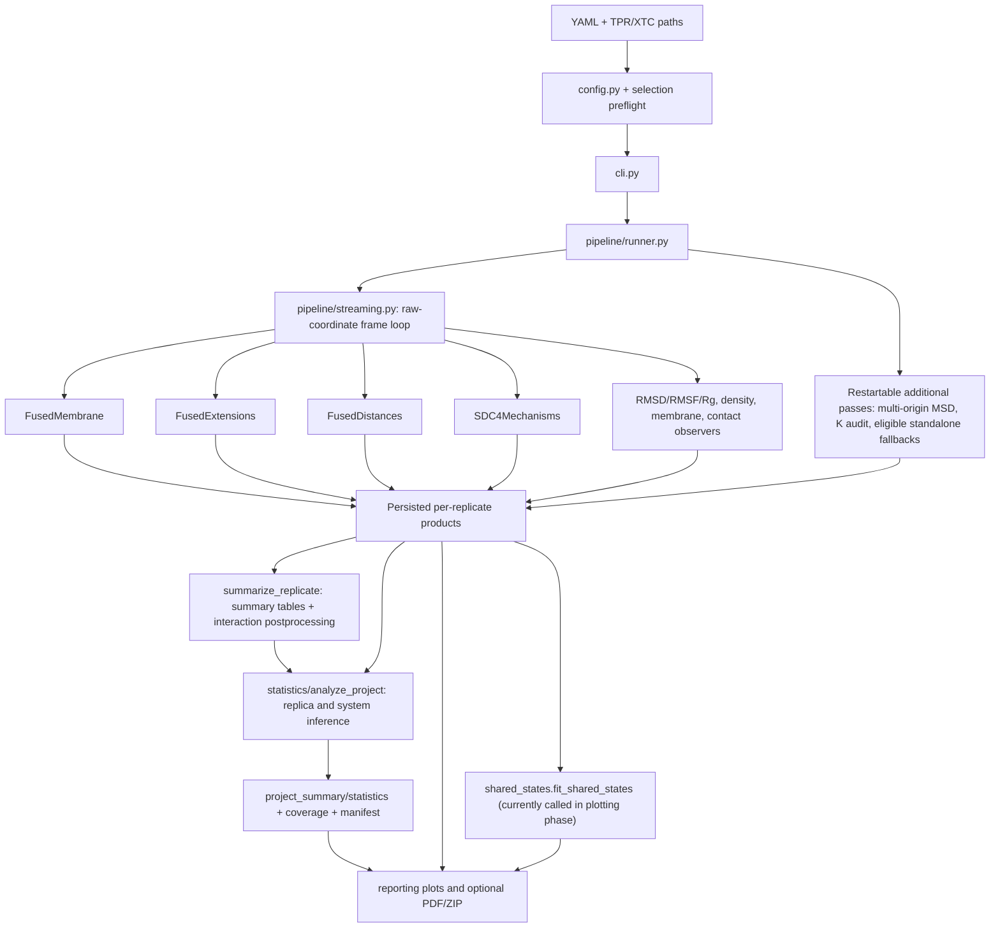

# Architecture and packaging

This guide consolidates the authoritative technical details formerly scattered across topic and implementation-history files. Sections retain their scientific caveats and validation limitations; consult the source code for the executable contract.

---

### MDscope architecture

See [REPOSITORY_RULES.md](contributing.md) for cleanup and refactoring
policy. This document records the current canonical module layout and dependency boundaries.

### Current canonical locations

- `src/mdscope/core/`: alignment, trajectory and provenance helpers, periodic
  geometry, atom selection, checkpoints, persistence.
- `src/mdscope/observables/`: RMSD, RMSF, radius of gyration, MSD, bilayer
  normal, lipid enrichment, membrane metrics/order, density, DSSP, SASA,
  structural profiles and residue–membrane distance.
- `src/mdscope/mechanisms/`: SDC4 conformational mechanisms, HS topology,
  mechanistic geometry, local environment and shared conformational states.
- `src/mdscope/statistics/`: replicate-aware inference, resampling, time-series, profile and interaction summaries.
- `src/mdscope/reporting/`: report PDF/ZIP generation, membrane and SDC4 figures,
  coupling-screen reporting and plots.
- `src/mdscope/cli.py`, `src/mdscope/config.py`, `src/mdscope/registry.py`: current
  CLI, configuration and registry entry points.

- `src/mdscope/interactions/`: hydrogen bonds, salt bridges, ligand contacts,
  lipid hydrogen bonds and shared interaction tables.
- `src/mdscope/pipeline/`: streaming, fused trajectory processing, orchestration,
  finalization and execution progress.

The former flat runner, streaming, progress, profiles and timeseries modules
have been removed; import implementations directly from their owning packages.

The repository intentionally does **not** preserve legacy Python import
aliases after a replacement is migrated. `mdscope` CLI commands and YAML
configuration stay unchanged unless a separate change is approved.

### Dependency direction

Core numerical kernels and observables must not import reporting. Pipeline
coordinates readers and observers; statistics operates on persisted numerical
results; reporting consumes finalized tables and images without rerunning
trajectories. Keep framewise computations fused and sparse where applicable.

### Quality gates

Use the existing Python 3.11/3.13 tests, wheel and CLI checks, and real
GROMACS smoke workflow. Structural refactors must preserve units, PBC
handling, atom and residue identity, output schemas and replicate indexing.
No new regression tests are required merely for relocating modules.
Verify the package from outside the source checkout as well as in-tree, and
check the real-GROMACS trajectory workflow before treating a refactor as
validated. GitHub check names correspond to `.github/workflows/mdscope-checks.yml`
and `.github/workflows/real-trajectory-smoke.yml`.

A passing smoke test establishes coverage for its tested configurations,
not numerical equivalence for every supported topology or analysis option.

### Issue #33 — observable and interaction ownership audit (2026-10-31)

The former `src/mdscope/timeseries.py`, `src/mdscope/profiles.py` and
`src/mdscope/interactions.py` facades were intentionally removed by earlier
architecture PRs; do not recreate compatibility wrappers for unsupported
imports. Numerical observables live under `observables/`, interaction
serializers and identity tables under `interactions/`, source/frame handling
under `core/trajectory_sources.py`, and the fused frame consumers under
`pipeline/`. `core/coordinate_contracts.py` documents provenance roles,
not absolute guarantees of input unwrapping. Pure kernels should be extracted
only when a real caller or numerical reference benefits; avoid a second
abstract observable framework.

Current tests cover direct FFT multi-origin MSD reference sums, independent
PBC geometry, topology-residue contacts, mixed protein–membrane and
membrane-only selections, explicit coordinate roles, and fused frame
lifecycle. Broader numerical, topology, and trajectory provenance validation
belongs to issue #36 rather than repeated architecture reorganization.

---

### Packaging and source layout

MDscope uses a conventional `src/mdscope/` package layout.
The public imports remain `mdscope.*` and the CLI remains `mdscope`.

Install from a checkout with `python -m pip install -e ".[dev]"`.
For HPC where dependencies already exist, `python -m pip install --no-deps -e .`
registers the checkout in the active environment; do not rely on a global
`PYTHONPATH` pointing to a named parent directory. Run `mdscope --help`,
`python -m mdscope.cli validate <config.yaml>`, or the existing
SLURM scripts after installing.

Build with `python -m build` and validate using `python -m twine check dist/*`.
Check both wheel and source distributions in clean virtual environments from
outside the repository. All seven functional subpackages are included through
setuptools package discovery, not a manually curated list.

The package relocation did not change scientific kernels, YAML schemas, output
paths, units, or trajectory passes. The supported imports are `mdscope.*`;
`mdscope.analysis.*` is not an alias. HPC scripts use the installed lowercase
package consistently.

### Offline reporting responsibilities

- `reporting/report_inventory.py`: persisted-table sampling/grouping and shared
  table-eligibility audit; no renderer or trajectory reads.
- `reporting/figure_inventory.py`: readable figures, recorded source availability, duplicate detection and coverage.
- `reporting/labels.py`: display labels shared by plots and PDF, without
  importing Matplotlib.
- `reporting/pdf.py`: ReportLab layout and inline visual presentation.
- `reporting/bundle.py`: bounded CSV previews, full eligible Parquet archives,
  audits and images; no PDF layout.
- `reporting/report.py`: staged export orchestration and established entry
  points. Existing CLI, PDF/ZIP names and bundle member paths remain stable;
  additional original Parquet members and table/content manifests are additive.

Reusable CLI/programmatic topology validation resides in `core/validation.py`.
Reporting operates on persisted outputs. No estimator, observer, coordinate transform
or trajectory pass is moved into reporting.

---

## Executable architecture map (repository audit: 2026-11-11)

This section maps the **implemented** call paths, persisted artifacts and change impact.
It complements the module-ownership rules above; it does not replace the scientific
definitions in [analyses](../analyses.md), [scientific contracts](scientific-contracts.md)
or [workflows](../workflows.md). Audit basis: the `main` repository tree (209 tracked
files), including production modules, tests, scripts, workflow definitions, YAML
configurations and existing documentation. **Static source review is not a passing
test or a production-trajectory validation.**

### Runtime entry points and phase boundaries

| Entry point | Owner and actual behavior |
| --- | --- |
| `mdscope init` | `cli.py:interactive_init`: write a starter YAML. |
| `mdscope validate CONFIG` | `cli.py:cmd_validate` → `config.load_config`, `config.iter_replicates` and `core.validation.validate_selections`. Reads input topologies/selections; does not generate analysis results. |
| `mdscope replicate CONFIG --index N` | `pipeline.runner.run_one` → `run_replicate` for one indexed system/replica. Does **not** finalize project statistics. Used by `run_mdscope.sh` array tasks. |
| `mdscope run CONFIG` | `pipeline.runner.run_all`: run every replicate, then `finalize_project(phase="all")`. |
| `mdscope statistics CONFIG` | `finalize_project(phase="statistics")`: validate existing replica products, then run project-level statistics without rereading XTC. Used by `statistics_mdscope.sh`. |
| `mdscope plotting CONFIG` | `finalize_project(phase="plotting")`: plotting **plus** shared-state fitting, project diffusion summaries, optional coupling screen, and report/bundle creation. Used by `plotting_mdscope.sh`; this is not yet a pure renderer. |
| `mdscope finalize CONFIG` | `finalize_project(phase="all")`: statistics followed by the plotting-phase operations. Used by `finalize_mdscope.sh`. |
| `mdscope report CONFIG` | `reporting.report.generate_report`: rebuild the optional PDF/ZIP from saved finalized results. |

YAML is parsed and merged with defaults in `config.py`. Multiple named analysis
instances are handled by `analysis_runs` (notably density, SASA and residue-to-membrane
distance). `registry.py` maps enabled outputs, analysis instances, completion
identities and required companion artifacts.

This is a **logical** map, not a claim of one trajectory pass in every
configuration. The normal protein/membrane run shares its raw-coordinate pass
with the fused observers; observer-only configurations can use `fused_all.py`.
Multi-origin MSD, potassium bridge audit and some DSSP configurations can
require separate reads. See [workflows](../workflows.md) for precise traversal
conditions and replay rules.

### Runtime owners: where to inspect before changing behavior

| Concern | Implementation | Downstream consumer / contract |
| --- | --- | --- |
| Input shape, analysis groups, options, named instances | `config.py`, `core/validation.py` | CLI, registry, every observer and statistics family |
| Source coordinates, alignment, synchronized raw MSD input | `core/trajectory_sources.py`, `core/alignment.py`, `core/coordinate_contracts.py` | Streaming, diffusion; do not rotate or center shared raw membrane coordinates |
| PBC, atoms, leaflets and lipid anchors | `core/geometry.py`, `core/lipid_geometry.py`, `core/atom_selection.py` | Membrane, contacts, HS, solvation and SDC4 observers |
| Frame/chunk lifecycle, regular scalar observables | `pipeline/streaming.py`, `pipeline/fused_all.py` | `raw/` parts, `cache/` and `summary/` |
| Fused observers | `pipeline/fused_membrane.py`, `pipeline/fused_extensions.py`, `pipeline/fused_distance.py` | Physical lipid metrics, H bonds/DSSP/SASA/solvation, named residue distances |
| Protein, membrane, density and diffusion kernels | `observables/` | Fused or standalone execution, profile extraction, statistics |
| Interaction events and lifetimes | `interactions/`, particularly `interaction_tables.py` | Presence/event/occupancy/lifetime products and interaction bootstrap |
| SDC4/HS mechanisms, shared states and chemical audit | `mechanisms/` | `extensions/sdc4_mechanisms/`, `project_summary/shared_states/`, potassium audit |
| Output contracts and restart | `registry.py`, `pipeline/runner.py:RunState`, `core/checkpoints.py`, `core/persistence.py` | Validation, resume and non-destructive failures |
| Project statistics | `statistics/__init__.py` and the family modules listed below | `project_summary/statistics/` |
| Figures and evidence exports | `reporting/` | Reads saved products; PDF/ZIP are optional presentation artifacts |

Ownership does not imply zero cross-package imports: some observables call
`pipeline.progress` for progress reporting, and statistics reuse profile
extractors defined next to their observables. Preserve the scientific contract
and trace the actual callers before moving code.

### Persisted data flow and retention boundaries

| Location under `project.output` | Producer | Why it matters |
| --- | --- | --- |
| `resolved_config.yaml`, `run_metadata.json` | `runner.initialize` | Resolved inputs, environment and version provenance |
| `.state/rep-*.json` | `RunState` | Stage completion and artifact inventory; stage identity is **not** a blanket code-hash gate |
| `<system>/<replicate>/raw/` | `streaming.py` | Part-numbered scalar/group time series, raw contact events, RMSF and other raw outputs |
| `<system>/<replicate>/cache/` | Streaming/fused observers | `stream_checkpoint.npz`, committed observer parts, optional aligned feature NPZ, density/profile parts; essential for efficient interrupted-run replay |
| `<system>/<replicate>/summary/` | `summarize_replicate` and downstream methods | `timeseries.parquet`, `group_timeseries.parquet`, diffusion summaries, and per-replica statistical/ACF tables |
| `<system>/<replicate>/profiles/` | Profile observers/postprocessors | Density, DSSP, SASA, lipid order, residue-distance arrays and their coordinate/selection metadata |
| `<system>/<replicate>/interactions/` | Interaction writers and postprocessing | Event, presence, occupancy, lifetime and count-time-series products |
| `<system>/<replicate>/extensions/` | Specialized/fused observers | Lipid neighbors/enrichment/normals, SDC4/HS, solvation/RDF and K-bridge evidence |
| `project_summary/statistics/` | `statistics.analyze_project` | Repeatable comparison tables, uncertainty, coverage, `manifest.json` |
| `project_summary/shared_states/` | `mechanisms.shared_states.fit_shared_states` | Model, assignments, populations and conditioned analyses; currently a plotting-phase side effect |
| `project_summary/` reporting outputs | `reporting/` | Plots, optional PDF/review ZIP and presentation provenance; not authoritative trajectory measurements |
| `.archives/` | `core.persistence.archive_output` as invoked during finalization | Prior project/statistics/report products are **moved**, not deleted; repeated finalization can increase disk usage |

**Current storage policy:** preserve the established observable outputs,
including valuable per-frame or per-residue arrays and restart caches. Do not
change file formats, downsample computed measurements, delete cache parts or
introduce a new database as an incidental consequence of a statistics or
documentation change. An eventual retention policy must classify *completed
products*, *restart-critical chunks* and *disposable presentation outputs*
separately. Check output integrity and downstream readers before any cleanup.

`registry.analysis_output_plan` and `registry.required_artifacts` are the
authoritative programmatic map for required observable companions. A primary
file existing by itself is not sufficient evidence of a complete analysis.
`runner._validate_analysis_output` and `validate_stream_inventory` protect
restarts/finalization from incomplete or inconsistent products.

### Statistics dependency and output map

`statistics.analyze_project` operates on **persisted** data from all
requested replicas; it does not reopen production trajectories. Its
`manifest.json` records methods, enabled families and completion status.
A pre/post file-stat snapshot detects input modifications during a run.
It calls the following families in sequence, then optional matched-window
time-series statistics and `coverage.write_contrast_coverage`:

| Family | Reads / estimator owner | Principal outputs under `project_summary/statistics/` |
| --- | --- | --- |
| Scalar and grouped time series | `statistics/time_series.py`, `common.py`; `summary/timeseries.parquet`, group tables, selected solvation/bridge/lipid contact series | `time_series/replicate_statistics.parquet`, `system_statistics.parquet`, `system_comparisons.parquet`, `autocorrelation.parquet` |
| Temporal profiles | `statistics/profiles.py`; profile accessors beside RMSF, density, SASA/DSSP, lipid order and residue-distance observables | `profiles/replicate_profiles.parquet`, `system_profiles.parquet`, `system_profile_statistics.parquet`, `system_comparisons.parquet` |
| Interaction occupancy and events | `statistics/interactions.py`, `interactions/interaction_tables.py`; saved presence/lifetimes and sampled frame times | `interactions/replicate_interaction_metrics.parquet`, `system_interaction_metrics.parquet`, `system_interaction_comparisons.parquet` |
| RDF shape and shell contrasts | `statistics/solvation.py`; per-replica `extensions/solvation/rdf.parquet` | `solvation/replicate_rdf.parquet`, `system_rdf.parquet`, `replicate_rdf_shells.parquet`, `rdf_shell_comparisons.parquet` |
| Shared-lag diffusion | `statistics/diffusion.py`; saved multi-origin MSD curves, refitted on common supported lags | `diffusion/replicate_common_lag_slopes.parquet`, `common_lag_comparisons.parquet` |
| Coupling | `statistics/coupling.py`; saved regular-grid series, replica correlations | `coupling/replicate_correlations.parquet`, `system_comparisons.parquet` |
| Second scalar window | `statistics/time_series.py` with configured `matched_window_ps` | `matched_time_series/`, alongside full-window results |
| Coverage audit | `statistics/coverage.py` | `coverage/contrast_coverage.parquet` |

For standard scalar, profile and interaction families, `common.py` provides
FFT autocorrelation, automatic temporal block length, moving-block bootstrap
within replica, hierarchical resampling across replicas, paired/independent
contrasts, permutation tests and Benjamini–Hochberg FDR. Adaptive two-endpoint
bootstrap Monte Carlo precision is available for scalar hierarchical CIs.
`replicate_contrasts.py` handles between-replica uncertainty for RDF-shell,
diffusion and coupling estimates; do **not** replace their estimators with
frame-level resampling. Pointwise RDF mean ± SD is descriptive, **not** a
confidence interval.

The full SDC4 YAML currently specifies three independent replicas per
condition, 5,000 bootstrap draws, 95% CIs, moving blocks, an independent
permutation design, and `statistics.interaction_min_occupancy: 0.20`. The
interaction filter retains identities meeting the occupancy threshold in
**at least one replicate** at the statistics stage; it does not erase raw
interaction observations. The finalization-fast YAML additionally excludes
lipid H-bond identity statistics without deleting their saved events.

**Statistical interpretation guardrails:**

- Individual trajectory frames are correlated observations, not biological
  or independent simulation replicates. Keep per-replica estimates visible.
- For independent 3-versus-3 replicas, a two-sided exact label-permutation
  test has 20 assignments and a smallest attainable p-value of 0.10. A
  percentile bootstrap CI excluding zero does **not** imply an exact
  permutation p-value below 0.05 or an FDR-significant finding.
- Incomplete or irregular time grids, conditional local geometry, missing
  interaction events and missing entire replica outputs have distinct
  meanings. Follow existing validity/coverage fields rather than dropping
  invalid frames or treating missing as physical zero.
- Review hierarchy behavior and uncertainty calibration before changing
  scientific conclusions: three replicas per condition place important
  limits on between-replica inference. `common._hierarchical`,
  `time_series.analyze_time_series`, `profiles.analyze_profiles` and
  `interactions.analyze_interactions` are the main review surfaces.
- Changes to per-frame quantities, replica aggregation, hypothesis families,
  uncertainty definitions or output schema are **scientific behavior changes**,
  not report-format refactors. Use the reference tests and real data before
  claiming numerical equivalence.

### Presentation is not yet separate from derived analysis

`reporting/plotting.py`, `membrane_figures.py`, `sdc4_figures.py` and
`solvation_figures.py` render from stored products; `figure_inventory.py`
tracks source availability and figure provenance. `report.py` orchestrates
PDF/ZIP exports through `pdf.py`, `bundle.py` and
`report_inventory.py`. These can be disabled or deferred without changing
observable collection.

However `runner.finalize_project(phase="plotting")` also calls
`shared_states.fit_shared_states`, `msd.summarize_project_diffusion`,
`msd.summarize_project_multi_origin` and optional
`reporting.coupling_screen.screen_couplings`. Some derived scientific
tables therefore depend on a command called "plotting". A later narrow
refactor should move **derived analyses** into an offline computation phase,
leaving an opt-in renderer. Do not simply remove `reporting/` or skip
`plotting` while those non-plot side effects remain necessary.

Repeated `statistics` and `finalize` runs can move previous summaries into
`.archives/project_summary/` and `.archives/statistics/`. Inventory archive
growth before introducing pruning; retain reproducibility and never delete
a possibly needed observable or restart chunk automatically.

### Change-impact checklist (choose only the relevant row)

| Intended change | Inspect/update together | Minimum regression target |
| --- | --- | --- |
| New/modified scalar observable | `config.py`, `pipeline/streaming.py` or relevant observer, `runner.summarize_replicate`, `statistics/time_series.py` | `test_streaming_smoke.py`, `test_data_integrity.py`, `test_statistics_controls.py` |
| New/modified temporal profile | Relevant `observables/*`, `statistics/profiles.py`, optional fused observer and registry contract | `test_fused_output_catalog.py`, `test_statistics_modes.py`, profile-specific reference tests |
| Molecular interaction/event change | `interactions/interaction_tables.py`, detector, `statistics/interactions.py`, persisted identity columns | `test_interaction_statistics_reference.py`, `test_interaction_tables_filter.py`, event-specific tests |
| SDC4, glycan, lipid or solvation science | `mechanisms/*` or `observables/solvation*`, `registry.required_artifacts`, YAML selections | `test_sdc4_geometry_references.py`, `test_solvation.py`, `test_scientific_reference_oracles.py` |
| Statistical estimator or reporting table | `statistics/common.py` and affected family, `coverage.py`, `reporting/figure_inventory.py` (if inference semantics change) | `test_publication_references.py`, `test_statistics_controls.py`, `test_statistics_modes.py`, `test_ci_coverage.py` |
| Checkpoint, restart or output schema | `core/checkpoints.py`, `core/persistence.py`, `registry.py`, `pipeline/streaming.py`, `pipeline/runner.py` | `test_checkpoint_integrity.py`, `test_mixed_observer_restart.py`, `test_issue128_restart_artifact_contract.py` |
| Pure figure/PDF change | `reporting/*` and presentation controls; avoid entering observers/statistical kernels | `test_presentation_controls.py`, `test_report_integrity.py`, `test_report_inventory.py` |
| SLURM/packaging/CLI | `run_mdscope.sh`, `statistics_mdscope.sh`, `plotting_mdscope.sh`, `finalize_mdscope.sh`, `pyproject.toml`, `cli.py` | `test_package_contract.py`, `test_cli_end_to_end.py`, `test_profiling_and_slurm.py` |

For code changes, follow [contributing](contributing.md): identify the
scientific contract, callers and failure modes, run the smallest useful
tests, then the applicable `.github/workflows/mdscope-checks.yml` and
real-trajectory smoke/physics checks. The release-reference workflow may
require GROMACS release data and is not guaranteed to run on ordinary PRs.
When Actions minutes are unavailable, run equivalent checks locally/ARC and
record the actual commands and outcomes.

### Prioritized architecture work, without changing observable storage

1. **Statistics quality audit:** map estimands and missing-data semantics for
   each family; examine replica weighting, block-length sensitivity, the
   bootstrap hierarchy and three-replica uncertainty. Improve statistical
   results only with independent numerical oracles and reference cases.
2. **Separate derived offline computation from figure generation:** preserve
   shared-state/coupling/diffusion tables when automatic plotting is disabled.
3. **Manage archives rather than stripping useful data:** measure archive and
   report duplication independently from trajectory/observer outputs.
4. **Maintain this map at the interface changed:** when adding an analysis or
   changing a persisted contract, update the relevant owner, output table and
   tests instead of creating a competing architecture guide.

---

## Output completeness and difference-discovery design

**Scope:** This is a plan for making saved scientific data discoverable **without
changing observable collection, existing persisted formats or statistical
estimators now**. Existing downstream code must remain compatible.

### Actual output-to-uncertainty coverage

The current `statistics/coverage.py:SOURCES` registers **seven** contrast
families: `time_series`, `matched_time_series`, `profiles`, `interactions`,
`coupling`, `diffusion` and `solvation_rdfs`. It audits candidate observations
from each family's **statistics-level replica output**; it does **not** inventory
every enabled raw observable or every specialized offline derivative.

| Persisted scientific product | Current uncertainty / contrast path | Gap to surface |
| --- | --- | --- |
| `summary/timeseries.parquet`, `summary/group_timeseries.parquet` and selected extension scalar series | `statistics/time_series.py`: replica, system and mean/median **difference** CIs where temporal support is valid | A user-friendly catalog is missing; values saved outside `collect_time_series` are not guaranteed a comparison. |
| Density, RMSF, SASA/DSSP, membrane-order and residue-distance temporal profiles | `statistics/profiles.py`: per-position comparisons and pointwise CIs | A [residue-region scan](../workflows.md#discovering-contiguous-protein-changes) ranks contiguous changes with complete, separated replica ranges. Unified whole-profile ranking remains proposed. Pointwise CIs should not be read as simultaneous confidence bands. |
| Contact, H-bond and salt-bridge events | `statistics/interactions.py`: per-identity occupancy, event-rate and lifetime contrasts when supported | High cardinality; default production `interaction_min_occupancy: 0.20` filters identities with <20% occupancy in every replica. Suppressed, disabled and unobserved identities need explicit statuses distinct from physical zero. |
| Solvation RDF curves | `statistics/solvation.py`: per-bin replica mean±SD (descriptive) and shell-integrated replica-level difference CIs | Whole RDF curve shape and peak-location differences do **not** currently have registered comparison intervals. |
| Multi-origin diffusion curves | `statistics/diffusion.py`: common-lag refitted replica slopes and difference CIs | Single-origin `project_summary/diffusion/` coefficients are currently descriptive only; report distinction and fit support. |
| Coupling correlation outputs | `statistics/coupling.py`: replica correlation contrasts | Descriptive screen, with limited independent-replica evidence. |
| Shared-state model, state-conditioned SDC4 analyses | `mechanisms/shared_states.py` creates several separate population and conditioned CI tables | Not part of the seven-family central `contrast_coverage` audit; some conditioned tables are descriptive only. |
| Lipid/solvent density maps, detailed spatial K bridge audit and other specialized outputs | Retained as source data; some summarized elsewhere | Not every saved high-dimensional map has a registered condition-level contrast or CI. Do not imply one exists. |

### Required audit before any expensive statistical rerun

Introduce a **catalog-first read-only audit** driven by configured analysis
instances, `registry.analysis_output_plan`/`required_artifacts` and actual
columns, coordinate labels and shapes of saved files. Inventory
statistically eligible products **before** running estimators.

The audit should produce an entry for every enabled and saved observable, plus
enabled-but-missing outputs, with fields:

- `observable_id`, `analysis_instance`, `family`, `measure`, `units`,
  `dimensions`, `selection`/chemical identity, `source_path`, `schema_version`.
- `system`, `replicate`, `time_start_ps`, `time_end_ps`,
  `n_observations`, `n_finite`, `n_expected_replicates`, `n_available_replicates`,
  and source QC/availability.
- `comparison_eligible`, `comparison_method`,
  `comparison_status` and a reason if unavailable, filtered or not implemented.

**Completeness invariant:** every configured scientific output belongs to
exactly one of (1) a recorded condition-comparison result, (2) a documented
descriptive-only output, (3) an intentionally excluded candidate, or (4) an
explicitly missing/invalid/unsupported result with a reason. Never equate
`not_tested`, `no_observed_events`, `no_valid_frames` or `filtered` with
`no_effect`. A completed project-level statistics manifest alone does not
prove full scientific comparison coverage.

### Shared presentation schema, not a data-format migration

Preserve all existing raw Parquet/NPY/NPZ paths and the current family-specific
tables. Add **small derived normalized views** under a dedicated project-level
catalog folder; do not flatten large arrays or atom-event tables merely to
standardize them.

- `observable_catalog.parquet`: one row per registered measurement
  identity/coordinate and its provenance, availability and supported estimator.
- `estimates.parquet`: one row per replica or condition estimate,
  keyed by `family, observable_id, coordinate_id, system, [replicate],
  statistic`; numeric fields `estimate, ci_low, ci_high`, units, coverage and
  estimator metadata.
- `comparisons.parquet`: one row per condition-pair/metric/coordinate/estimand:
  `system_1, system_2, difference_system2_minus_system1,
  ci_low, ci_high, ci_level, p_value, q_value, n_replicates_1,
  n_replicates_2, method, status`. Missing intervals remain null with a reason.
- `discovery.parquet`: one row per *scientifically meaningful family or region*
  with effect magnitude, direction, replicate agreement, support, rank,
  exploratory/confirmatory status and a link to underlying comparison rows.
- `coverage.parquet`: extended source-to-estimate-to-comparison reconciliation,
  including dedicated analyses outside the seven core statistics families.

The identity schema must preserve chemical/molecular semantics: units,
residue numbers **and topology indices**, protomer, HS chain, lipid species,
leaflet, group/motif, measured quantity, physical position and normalization
reference as applicable. Use structured columns and stable IDs; do not encode
all identity solely in a presentation label. Maintain a distinction between
population occupancy, event rate, event lifetime, RDF shape, surface-area
burial, diffusion slope and correlations.

A narrow reader/normalizer for each existing statistics family is sufficient;
do not introduce a database, rewrite the collector, or build a competing
analysis framework. Views should be regenerable from saved outputs.

### High-dimensional candidate selection before expensive per-feature CIs

User goal: identify chemically or structurally meaningful *differences*
rather than the directions with greatest combined variance (the PCA goal).
Prefer a **difference-first, replica-aware discovery stage**:

1. **Cheap deterministic inventory and screening:** from existing saved
   replica summary values/curves, compute the condition contrast, within-
   condition replica dispersion, independent-replica consistency, and
   observation/selection support for *every* candidate. Retain all rows.
   Compare like chemical sites and the same profile coordinate/normalization.
2. **Scientific grouping before individual tests:** for ordered profiles,
   report whole-curve contrasts (e.g. integrated absolute difference and
   region-wise signed differences) and pre-specified contiguous regions; for
   unordered interactions, group by motif/residue domain, lipid species,
   leaflet, or bridge class and screen group occupancies. Never treat
   adjacent radial bins or frames as independent replicates.
3. **Prioritize follow-up CIs:** compute detailed per-residue/bin/interaction
   bootstrap intervals for high-support, high-effect candidates plus
   predeclared primary hypotheses. Preserve a searchable descriptive screen
   for every remaining candidate, marked `not_ci_evaluated`, not `nonsignificant`.
4. **If formal inference on adaptively selected features is desired:** avoid
   interpreting same-data-selected pointwise intervals as confirmatory.
   Pre-specify regions, use properly calibrated simultaneous intervals or
   global profile tests, and/or confirm findings in independent new replicas.
   Selecting within a trajectory and then treating another temporal window
   as an independent validation dataset is invalid.
5. **Rank, don't automatically claim significance:** simple standardized
   contrast/replicate-consistency/coverage scores are *discovery heuristics*,
   not p-values or posterior probabilities. With three independent replicas
   per condition, guard against artificially large standardized effects
   when between-replica variance happens to be near zero.

**Method options for later evaluation:** functional-data global curve tests,
simultaneous confidence bands or cluster-based permutation for ordered
residue/radial/distance profiles; physically motivated region aggregation;
cheap sparse-feature effect screens for large interaction sets. PCA finds
directions of **total variance**, not necessarily the between-condition
difference. Supervised PLS-DA/feature-selection models have high overfitting
risk with only six independent simulations and are **not** the default.

For every family, produce at minimum a **whole-family/region-level answer**
when possible even if per-coordinate CIs are selectively deferred. Some
outputs are legitimately descriptive-only (e.g. 3D maps or RDF bins) until
an estimand and uncertainty method are specified. Do **not** promise all
possible per-atom/per-bin CIs merely because the corresponding numerical
observable was saved.

### Recommended first implementation (future PR)

- Read-only coverage/catalog prototype on the six-replica saved output trees.
  No XTC traversal; record raw-observable → summary → contrast paths.
- Normalize the **existing** comparison tables into one queryable view,
  preserving exact original files and full CI/status metadata.
- Add lightweight deterministic contrast/effect/support ranking to profile
  and interaction families; benchmark screening cost and verify nothing
  silently disappears from the catalog.
- Add any new statistical estimator only later, after explicit scientific
  estimand definitions, independent reference tests, and six-replica
  validity checks.

This design intentionally separates **exhaustive awareness of the saved
measurements** from **selectively expensive confidence-interval computation**,
and preserves the option to revisit every candidate without regenerating the
trajectory observables.
