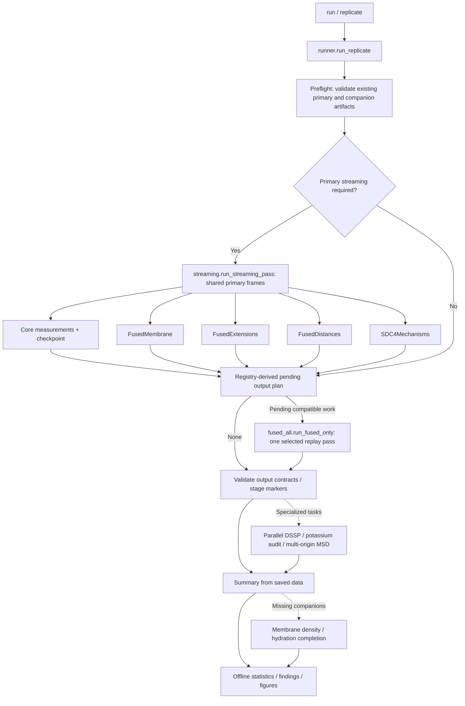
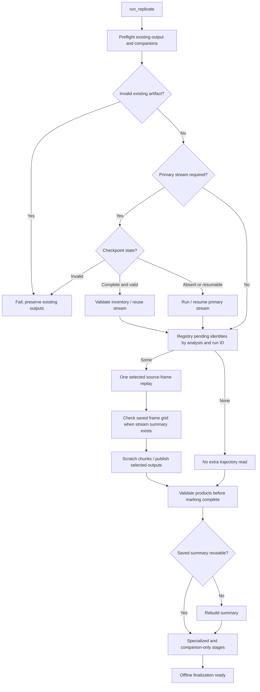
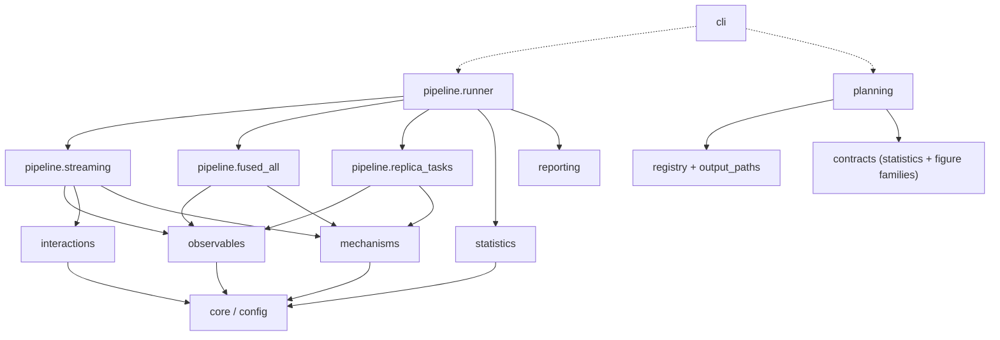

# Pipeline graphs

Three different questions need separate diagrams: **execution** (where
frames pass), **recovery** (when saved products are reused or replayed),
and **imports** (Python source dependencies). An import edge does not mean
an analysis opened a trajectory.

Regenerate all diagrams from a checkout:

```bash
python scripts/pipeline_graphs.py --output /tmp/mdscope-graphs
# Graphviz's dot executable is optional for SVG rendering.
# Open execution.svg, recovery.svg and imports_focused.svg (or their DOT files).
```

The script regenerates the existing AST inventory using
`scripts/architecture_map.py`; it also writes `recovery.dot`, `imports_full.dot`, and all four SVGs when
Graphviz is installed. Execution and recovery diagrams are **code-reviewed
conceptual flow maps**, not instrumented traces. Its
conditions must be reviewed when `runner.py`, `streaming.py` or
`fused_all.py` scheduling changes.

## Execution: where trajectories are read



**Reading this graph:** solid arrows show possible execution flow, not
simultaneous calls; dashed arrows show conditions. All fused observer families
consume the same **source-coordinate** frame before alignment in the primary
stream, and can also run under observer-only scheduling. Some standalone or
recovery operations reopen trajectories. The runner validates existing artifacts rather than assuming that files
are valid. In observer-only execution it selects **pending (analysis, run ID)**
pairs; completed named SASA and distance outputs are not recomputed. Replay
chunks are staged separately from committed streaming chunks. `fused_all.run_fused_only` is the only fused replay loop: the former per-family `run_fused_membrane` / `run_fused_extensions` / `run_fused_distances` copies were removed (#279), so the replica coordinator, tests and the real-data parity check share one trajectory/chunk lifecycle after either streaming or observer-only selection.

## Recovery: reuse, replay, or fail safely

This is **separate from execution** because output completeness and
checkpoint provenance—not just the enabled analysis set—determine whether a
trajectory must be reopened.



**Recovery contract:** existing invalid primary or companion artifacts fail
preflight; the pipeline must not silently replace them. Absent outputs can
be computed, and an incomplete lipid footprint lacking its commit reference
can be rebuilt. SDC4 residue occlusion has a documented companion-only
completion path. Complete streaming checkpoints must pass their chunk
inventory validation. If a non-streaming configuration has several pending
fused families, they share **one** source-frame traversal. A stream-enabled configuration now replays compatible pending outputs in one shared source-frame pass after confirming the saved frame grid.

Scratch replay chunks are discarded after successful publication; completed
outputs are not regenerated just because another run in the same family is
missing. This diagram is conceptual: see `runner.py`,
`fused_all.py` and each observer's validation for exact failure modes.

### #279 baseline and measured boundaries

**Before**: merged `main` revision `2faacb0489fcd215e1b28ce27893ea575c510752`.
The coordinator contained four independent per-family fallback branches (membrane,
extensions, distance and SDC4). Each could open a separate trajectory after a
completed primary stream. **After**: one derived set of pending registry outputs
and one call to the existing fused shared-frame replay executor, irrespective
of which compatible families are missing.

| Scenario | Previous extra fused trajectory passes | New extra fused trajectory passes |
|---|---:|---:|
| No-op; all outputs validated | 0 | 0 |
| Observer-only with multiple pending families | 1 | 1 |
| Completed primary stream, one pending family | 1 | 1 |
| Completed primary stream, three compatible missing families | Up to 3 | 1 |
| Completed primary stream, four compatible missing families | Up to 4 | 1 |
| Invalid existing companion | Fail before replay | Fail before replay |
| Multi-origin MSD, specialized DSSP, potassium, occlusion-only | Separate as needed | Unchanged |

These are **control-flow pass counts**, not performance benchmarks.
The synthetic recovery test counts Universe opens **and decoded frame
iterations** for one three-family replay, verifies selected numerical
products and preserves an unchanged completed sibling. A separate test checks
observer-only reuse with zero additional opens; corrupt timestamp and shorter
saved time grids must fail without rewriting completed artifacts or markers. Distance
finalization now reuses its already-open Universe for metadata at the
original frame-zero selection context and restores the observer's frame,
avoiding one additional *constructor* that previously did **not** traverse
trajectory frames. This may introduce a pair of targeted frame seeks, so
wall time and total I/O must be measured rather than inferred. The shared recovery stage is recorded as `fused-recovery` rather than
assigning the same wall time to multiple families. Historical stage-marker
`fused_into` values are preserved; each successfully finalized observer
can publish a validated marker even if a later observer fails. A failed or
unpublished sibling remains unmarked. Real GROMACS trajectory smoke, memory,
CPU/I/O and wall-time comparisons are required before merging or claiming a
runtime speedup.

## Dependencies: what imports what

This compact graph shows the relevant layers; the generated DOT/SVG files above
contain **actual current import edges**, including conditional imports and
cycles, rather than this intentionally simplified overview.



**Dependency legend:** solid arrows represent architectural dependencies in
this simplified diagram; dashed arrows represent deferred/command-specific
imports. In generated import graphs, a solid arrow means a module-load import
and a dashed arrow means a deferred import. A purple edge (when present)
identifies a multi-module strongly connected component. An import does **not**
prove that an analysis ran or a trajectory was opened.

## What each package owns

| Package | Responsibility | Examples |
|---|---|---|
| `core/` | Shared geometry, coordinate contracts, checkpoints, selection utilities | Minimum-image distances and frame provenance |
| `observables/` | **Measure** physical quantities, often directly from trajectory frames | RMSD/RMSF, SASA, membrane order, lipid enrichment, water coordination |
| `interactions/` | Detect and persist molecular contact/event relationships | H bonds, salt bridges, lipid contacts |
| `mechanisms/` | Generic scientific features and models, including saved-data states | Local environments, motif residence, occlusion, shared conformational states |
| `systems/sdc4/` | SDC4-specific observers and chemistry | SDC4 motif/HS geometry and potassium bridge audit |
| `pipeline/` | Decide **when/how** implementations run and resume; owns the shared frame loops | Streaming, fused observers, fallback dispatch |
| `statistics/` | Compare replicas, estimate uncertainty, and evaluate contrasts from saved products | Hierarchical/bootstrap CIs, RDF contrasts |
| `reporting/` | Present saved results, without reopening trajectories | Figures and findings |

An *observable* is not merely a post-hoc grouping of existing tables: many
perform PBC-aware coordinate calculations on each frame. Offline aggregation
and inference belong in `statistics/`, while display-only grouping belongs
in `reporting/`.

`systems/sdc4/` is intentionally separate from `pipeline/`: SDC4
and HS science is **what** is measured, whereas `pipeline/` owns **when** it
runs. In particular, `mechanisms/shared_states.py` works from saved features
and does not need a trajectory pass; `SDC4Mechanisms` is a per-frame observer.
Moving all mechanisms under `pipeline/` would conflate scheduling with
domain-specific scientific implementations.

**Refactor test:** share PBC geometry, atom selection and frame plumbing when
the numerical definitions agree. Do not collapse physically different
estimators into one generic observer just because they have similar output
tables. Prefer eliminating redundant trajectory passes and duplicate
aggregation contracts before moving package boundaries.


## Boundary diagnostics and safe recovery

These are **failure categories**, not fallback-to-zero behaviors. Errors should
identify the affected system/replica or saved file, while leaving committed
outputs unchanged.

| Boundary | Condition | What to inspect / safe next action |
|---|---|---|
| `validate`, `plan --check-topology`, `replicate` | Unreadable topology or invalid/empty MDAnalysis selection | Check the reported topology path, system and selection; correct the YAML/topology before running |
| `replicate` resume | Corrupt checkpoint or committed chunk inventory | Inspect the reported replica checkpoint and committed artifacts; archive the affected replica before any clean restart rather than deleting chunks to bypass validation |
| `statistics` / `finalize` | Missing, invalid or nonmonotonic saved replica summary/required companion | Finish or inspect the named replica and file; never interpret missing data as zero or silently overwrite earlier results |
| `plotting` | Selected statistical figure lacks completed statistics | Complete statistics first, or select a descriptive-only figure supported by the saved replicas; plotting does not infer missing CIs |
| `report STATISTICS_DIR` | Missing/invalid manifest or contrast-coverage file | Inspect the named statistics directory; complete the statistical export before regenerating findings; preserve existing findings |

The production checks live in `pipeline/preflight.py`,
`pipeline/streaming.py::validate_stream_inventory` and
`pipeline/runner.py::_validate_replica_products` and
`reporting/report.py::generate_report`. The **recovery graph**
above describes their ordering; topology-only preflight does not read an XTC,
and statistics/plotting reuse saved products. Keep this table as the single
developer reference for failure categories; Studio should use these existing
backend failures rather than inventing separate validation semantics.
