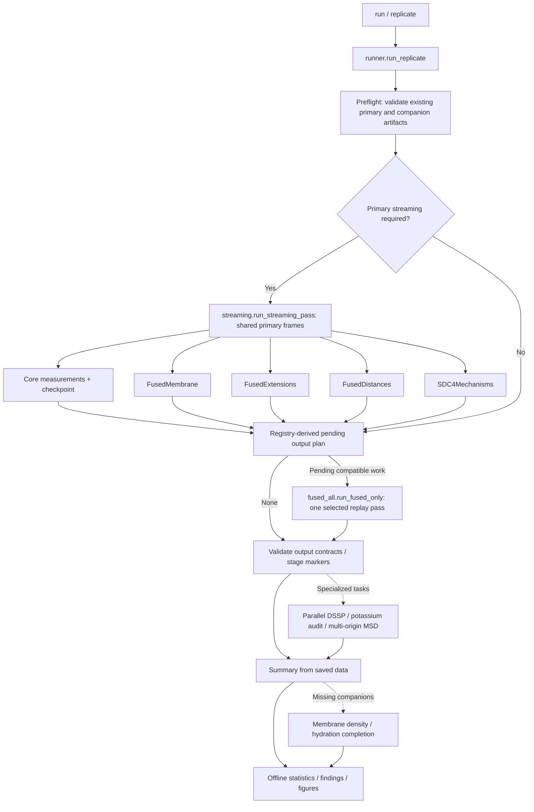
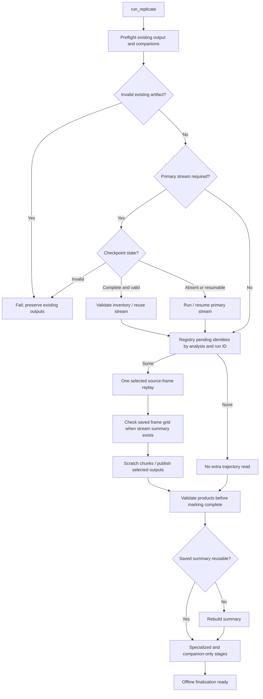

# Pipeline graphs

Two questions need separate diagrams: **execution** (where frames pass) and
**recovery** (when saved products are reused or replayed). Both are
**code-reviewed conceptual flow maps**, not instrumented traces, and this page
is their only copy: review them whenever `runner.py`, `streaming.py` or
`fused_all.py` scheduling changes. Python import dependencies are a third,
unrelated question (an import does not mean a trajectory was opened); their
diagram is generated from the source in
[Architecture](architecture.md#packages-and-dependency-direction).

## Execution: where trajectories are read

**Reading this graph:** solid arrows show possible execution flow, not
simultaneous calls; dashed arrows show conditions. All fused observer families
consume the same **source-coordinate** frame before alignment in the primary
stream, and can also run under observer-only scheduling. Some standalone or
recovery operations reopen trajectories. The runner validates existing artifacts rather than assuming that files
are valid. In observer-only execution it selects **pending (analysis, run ID)**
pairs; completed named SASA and distance outputs are not recomputed. Replay
chunks are staged separately from committed streaming chunks. `fused_all.run_fused_only` is the only fused replay loop, so the replica coordinator, tests and the real-data parity check share one trajectory/chunk lifecycle after either streaming or observer-only selection.

## Recovery: reuse, replay, or fail safely

This is **separate from execution** because output completeness and
checkpoint provenance—not just the enabled analysis set—determine whether a
trajectory must be reopened.

**Recovery contract:** existing invalid primary or companion artifacts fail
preflight; the pipeline must not silently replace them. Absent outputs can
be computed, and an incomplete lipid footprint lacking its commit reference
can be rebuilt. SDC4 residue occlusion has a documented companion-only
completion path. Complete streaming checkpoints must pass their chunk
inventory validation. If a non-streaming configuration has several pending
fused families, they share **one** source-frame traversal. A stream-enabled configuration now replays compatible pending outputs in one shared source-frame pass after confirming the saved frame grid.

Scratch replay chunks are discarded after successful publication; completed
outputs are not regenerated just because another run in the same family is
missing. This diagram is conceptual: see `runner.py`,
`fused_all.py` and each observer's validation for exact failure modes.

## Boundary diagnostics and safe recovery

These are **failure categories**, not fallback-to-zero behaviors. Errors should
identify the affected system/replica or saved file, while leaving committed
outputs unchanged.

| Boundary | Condition | What to inspect / safe next action |
|---|---|---|
| `validate`, `plan --check-topology`, `replicate` | Unreadable topology or invalid/empty MDAnalysis selection | Check the reported topology path, system and selection; correct the YAML/topology before running |
| `replicate` resume | Corrupt checkpoint or committed chunk inventory | Inspect the reported replica checkpoint and committed artifacts; archive the affected replica before any clean restart rather than deleting chunks to bypass validation |
| `statistics` / `finalize` | Missing, invalid or nonmonotonic saved replica summary/required companion | Finish or inspect the named replica and file; never interpret missing data as zero or silently overwrite earlier results |
| `plotting` | Selected statistical figure lacks completed statistics | Complete statistics first, or select a descriptive-only figure supported by the saved replicas; plotting does not infer missing CIs |
| `report STATISTICS_DIR` | Missing/invalid manifest or contrast-coverage file | Inspect the named statistics directory; complete the statistical export before regenerating findings; preserve existing findings |

The production checks live in `pipeline/preflight.py`,
`pipeline/streaming.py::validate_stream_inventory` and
`pipeline/runner.py::_validate_replica_products` and
`reporting/report.py::generate_report`. The **recovery graph**
above describes their ordering; topology-only preflight does not read an XTC,
and statistics/plotting reuse saved products. Keep this table as the single
developer reference for failure categories; Studio should use these existing
backend failures rather than inventing separate validation semantics.
