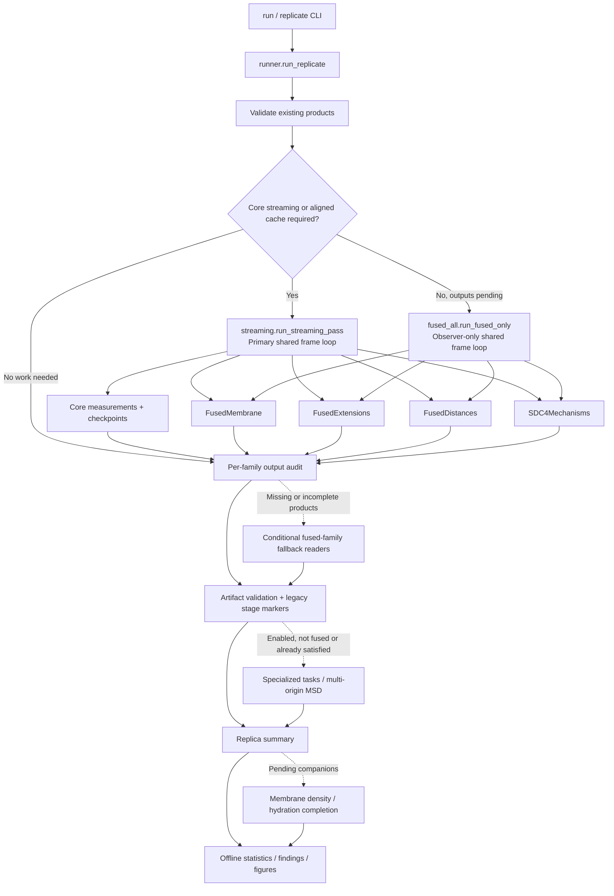
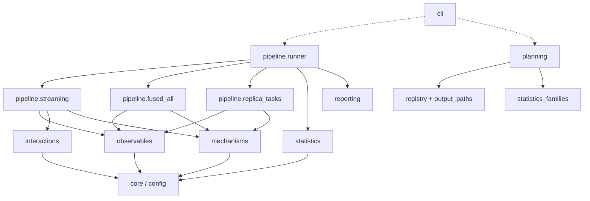

# Pipeline graphs

Two different questions need two different diagrams. The **execution graph**
describes trajectory passes and recovery. The **import graph** describes Python
dependencies; an import arrow does not imply a new trajectory traversal.

Regenerate both from a checkout:

```bash
python scripts/pipeline_graphs.py --output /tmp/mdscope-graphs
# Graphviz's dot executable is optional for SVG rendering.
# Open execution.svg and imports_focused.svg, or the corresponding DOT files.
```

The script regenerates the existing AST inventory using
`scripts/architecture_map.py`; it also writes `imports_full.dot` and, when
Graphviz is installed, `imports_full.svg`. The execution diagram is a
**code-reviewed conceptual control-flow map**, not an instrumented trace. Its
conditions must be reviewed when `runner.py`, `streaming.py` or
`fused_all.py` scheduling changes.

## Execution: where trajectories are read



**Reading this graph:** solid arrows show possible execution flow, not
simultaneous calls; dashed arrows show conditions. All fused observer families
consume the same **source-coordinate** frame before alignment in the primary
stream, and can also run under observer-only scheduling. Some standalone or
recovery operations reopen trajectories. The runner checks persisted artifact
integrity rather than assuming that existing files are valid. The observer-only
path and per-family fallbacks should be audited for overlapping work before
changing scheduling.

## Dependencies: what imports what

This compact graph shows the relevant layers; the generated DOT/SVG files above
contain **actual current import edges**, including conditional imports and
cycles, rather than this intentionally simplified overview.



**Dependency legend:** solid arrows represent architectural dependencies in
this simplified diagram; dashed arrows represent deferred/command-specific
imports. In generated import graphs, a solid arrow means a module-load import
and a dashed arrow means a deferred import. A purple edge (when present)
identifies a multi-module strongly connected component. An import does **not**
prove that an analysis ran or a trajectory was opened.

## What each package owns

| Package | Responsibility | Examples |
|---|---|---|
| `core/` | Shared geometry, coordinate contracts, checkpoints, selection utilities | Minimum-image distances and frame provenance |
| `observables/` | **Measure** physical quantities, often directly from trajectory frames | RMSD/RMSF, SASA, membrane order, lipid enrichment, water coordination |
| `interactions/` | Detect and persist molecular contact/event relationships | H bonds, salt bridges, lipid contacts |
| `mechanisms/` | System-specific **scientific features and models**; some are per-frame, others use saved results | SDC4 motif/HS geometry, HS hydration, shared conformational states |
| `pipeline/` | Decide **when/how** implementations run and resume; owns the shared frame loops | Streaming, fused observers, fallback dispatch |
| `statistics/` | Compare replicas, estimate uncertainty, and evaluate contrasts from saved products | Hierarchical/bootstrap CIs, RDF contrasts |
| `reporting/` | Present saved results, without reopening trajectories | Figures and findings |

An *observable* is not merely a post-hoc grouping of existing tables: many
perform PBC-aware coordinate calculations on each frame. Offline aggregation
and inference belong in `statistics/`, while display-only grouping belongs
in `reporting/`.

`mechanisms/` is intentionally a sibling of `pipeline/`, not a child: SDC4
and HS science is **what** is measured, whereas `pipeline/` owns **when** it
runs. In particular, `mechanisms/shared_states.py` works from saved features
and does not need a trajectory pass; `SDC4Mechanisms` is a per-frame observer.
Moving all mechanisms under `pipeline/` would conflate scheduling with
domain-specific scientific implementations.

**Refactor test:** share PBC geometry, atom selection and frame plumbing when
the numerical definitions agree. Do not collapse physically different
estimators into one generic observer just because they have similar output
tables. Prefer eliminating redundant trajectory passes and duplicate
aggregation contracts before moving package boundaries.
