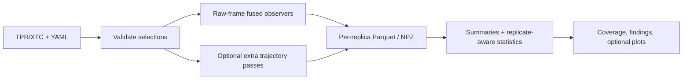
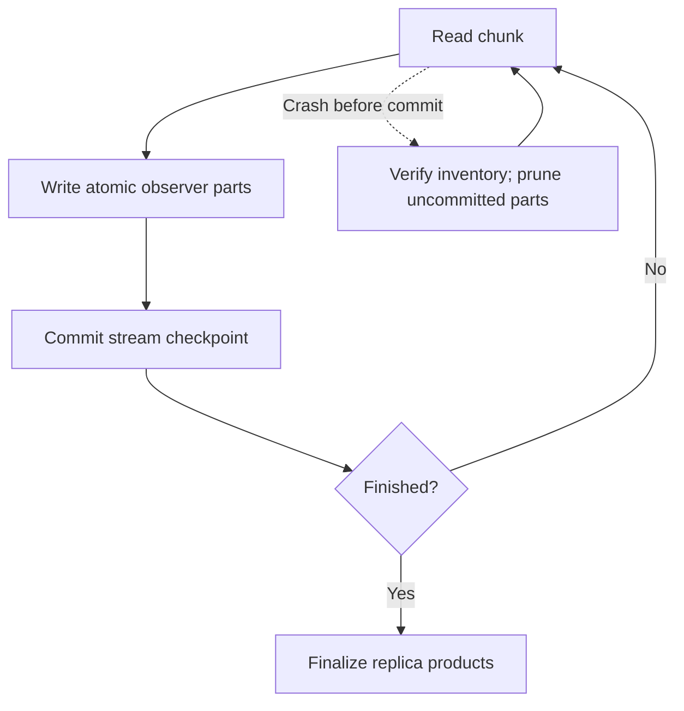

# Workflows and saved results

## Run a full SDC4 analysis

`synd4_full_mechanisms.yaml` configures two membrane conditions and **six replicas**; its output directory is separate from `synd4_baseline.yaml`.

```bash
python -m pip install -e '.[sasa]'
mdscope validate synd4_full_mechanisms.yaml
mdscope run synd4_full_mechanisms.yaml

# On an array/HPC run, process replicas first; then:
mdscope finalize synd4_full_mechanisms.yaml

# Recalculate from saved replica outputs, no XTC reread:
mdscope statistics synd4_full_mechanisms.yaml
mdscope plotting synd4_full_mechanisms.yaml
```

Use `run_mdscope.sh`, `statistics_mdscope.sh`, `plotting_mdscope.sh` and `finalize_mdscope.sh` with your validated YAML on Slurm. `run` performs replica processing **and** numerical finalization; `replicate --index N` processes one replica without project finalization.

The statistics job reports its current stage and elapsed time in `slurm-out/mdscope/mdscope_statistics-<jobid>.out`. Long stages print a heartbeat every minute. Set `progress.enabled: false` to suppress progress messages.

## Selective statistics (issue #179)

Use exact **saved** metric identities. Omitting `statistics.metric_selection`
preserves legacy inference; a family set to `[]` skips its statistics without
disabling raw analyses.

```yaml
statistics:
  metric_selection:
    time_series:
      - {group: PROA, metric: rmsd_A, ci: true, hypothesis_tests: false}
      - {metric: membrane_thickness_A, inference: false}
    interactions:
      - {kind: salt_bridges, metric: occupancy}
    profiles:
      - {profile: rmsf}
    solvation_rdfs:
      - {solvent: water, target_class: protein, site_class: acidic}
    diffusion:
      - {metric: DOPC}
    coupling:
      - {mechanism: membrane_coupling}
plots:
  include: ["time_series:rmsd_A:bootstrap_table"]
```

| Family | Identity | Selectable inference |
|---|---|---|
| `time_series` | `group`, `metric` | CI, hypothesis tests |
| `interactions` | `kind`, optional `interaction`, optional `metric` | CI, hypothesis tests |
| `profiles` | `profile` | CI, hypothesis tests |
| `solvation_rdfs` | `solvent`, `target_class`, `site_class` | Shell contrast |
| `diffusion` | `metric` | Replicate contrast |
| `coupling` | `mechanism` | Replicate contrast |

Selectors default to `inference: true`. Use `inference: false` for
descriptive-only statistics; for the first three families, `ci` and
`hypothesis_tests` can be toggled separately. Unsupported estimator
combinations fail validation. All requested identities must exist in saved
data; example IDs above are illustrative. An omitted interaction identity
selects every identity of that kind, and an omitted interaction metric
selects all five supported interaction statistics. The existing occupancy
threshold still applies.

`mdscope plan` exposes analysis/run candidates, identity fields, estimator
eligibility, conditional files, and figure-ID patterns without reading XTCs.
For completed outputs, `mdscope.planning.inspect_saved_statistics(root)`
reads actual Parquet schemas and saved IDs with a bounded identity limit.
Dynamic IDs are never invented.

Raw analyses, metric inference, and `plots.include` are independently
controlled. CIs and p/q-values are null when inference is disabled; paired
design and replica-level uncertainty rules are unchanged. Selective
Monte Carlo streams are identity-stable; BH q-values may change when the
hypothesis family changes. Statistics reruns archive previous products.
See #156 for deeper per-metric bootstrap-kernel factorization.

## Data flow



| Stage | Operations | Extra XTC pass? |
|---|---|---|
| Shared source loop | RMSD/RMSF/Rg, bilayer geometry/APL/MSD, lipid order/normals/enrichment, density, contacts, H bonds, serial DSSP, SASA, SDC4, residue distances | No extra pass for enabled fused observers |
| Optional/specialized | Multi-origin MSD, potassium bridge audit, some DSSP backends | **Yes**, independently restartable |
| `summarize_replicate` | Merge framewise output; compute profiles and interaction derivatives | No |
| `statistics`/`finalize` | Replica/bootstrap comparisons, RDF/diffusion/coupling, shared states, coverage and findings | No |
| `plotting`/`report` | Render saved tables and figures | No |

**Source frames remain unrotated by protein fitting.** Protein H bonds/DSSP reuse MDAnalysis private `_single_frame` interfaces: rerun real-data parity tests after MDAnalysis upgrades. Per-leaflet lipid order fixes initial cohorts; normals/enrichment recalculate leaflets. See [Scientific contracts](developer/scientific-contracts.md).

## Restart and file retention



- Parts: `<replica>/cache/fused_{membrane,extensions,distance}/`, with numbered Parquet/NPZ files.
- Committed parts are validated by identity, metadata/inventory and required companion files; incomplete or corrupt products fail safely.
- Only **uncommitted** parts are pruned/replayed. Keep restart caches until the stream completion marker is written.
- `fused_*_timings.json` and `stage_timings.json` record where time is spent.
- Numerical reruns archive prior results in `.archives/`; archives can consume disk. Do not treat a completed marker alone as scientific validation.

## SDC4 topology checkpoints

The original release TPRs contain **three attached HS chains per protomer**:

| Protein | Covalent serine OG attachments |
|---|---|
| PROA | S39, S61, S63 |
| PROB | S309, S331, S333 |

`hs_auto` follows **covalent glycan components**, not `chainID`; HS sugars share PROA/PROB IDs with their protein. Rebuilt topologies need a new attachment audit.

Before production, check selections for water/ions, NxIP, GGIVG, lipid anchors, six HS chains and valid analysis frames. In the older topology, GGIVG was found in PROA, not PROB; a missing motif must not become a measured zero.

The full SDC4 workflow includes protein/TM geometry, HS hydration/contact/ion measures, lipid organization and maps, isolated/environment SASA, water/ion RDFs, bridge evidence, multi-origin MSD and replica-level statistics. The **complete enabled list and atom selectors live in the YAML**, not here.

- Membrane-relative density: phospholipid phosphate midplane, equal leaflet weight, ±100 Å fixed grid for SDC4; follows translation, **not** tilt/undulation.
- Local thickness/curvature: use comparable phospholipid anchors and supported planar geometry.
- Environment SASA: ensure the whole target is appropriately imaged and clear of periodic faces.
- New lipid footprint/residue hydration/HS sugar outputs can require a **new trajectory pass for missing products**; re-finalize statistics afterwards.

## Find and interpret results

| Path under `project.output` | Read it for |
|---|---|
| `<system>/<replica>/summary/` | Scalar metrics, diffusion and per-replica summaries |
| `<system>/<replica>/profiles/` | RMSF, density, SASA, membrane order, residue distances |
| `<system>/<replica>/interactions/` | Events, occupancy, residence/lifetimes |
| `<system>/<replica>/extensions/` | Solvation, lipid neighbors/footprint, SDC4/HS and K audits |
| `project_summary/statistics/findings.md` | Fast review of valid interval exclusions and coverage |
| `statistics/findings.parquet` | Exact finite contrasts excluding zero (exploratory until multiplicity checked) |
| `statistics/coverage/contrast_coverage.parquet` | All registered comparisons, including unavailable status |
| `statistics/output_inventory.parquet` | Saved products and Parquet row counts |
| `project_summary/shared_states/` | Model, frame assignments and replica populations |

```bash
mdscope report /path/to/project_summary/statistics
mdscope scan-residue-regions /path/to/project_summary/statistics
```

- Region scan: ≥3 consecutive residues on the same chain, finite in **every** expected replica, with nonoverlapping replica ranges and consistent direction; requires ≥2 replicas per condition. It is exploratory, **not** a simultaneous CI.
- RDF-shell contrasts average saved curves using shell volumes; multi-origin diffusion contrasts refit shared supported lag windows. Require complete replica coverage.
- Matched scalar windows: `statistics.matched_window_ps: auto` or `[start,stop]`. Coupling requires a common regular grid. HS episodes retain censoring.
- Relative membrane position and lipid density maps have distinct reference/area conventions; do not infer binding affinity from proximity.
- Three independent replicas per condition give limited permutation resolution; inspect temporal stability and each replicate before interpreting biological contrasts.

[Configuration](configuration.md) · [Analysis definitions](analyses.md) · [Scientific audit](developer/scientific-audit.md)


## Exploratory multimetric residue response heatmap (#203)

The ordinary profile statistics phase now writes
`project_summary/statistics/profiles/residue_response_matrix.parquet` and
`residue_response_regions.parquet` when saved residue-profile contrasts exist.
These are **descriptive, data-selected regions**, not functional sequence
motifs or independently tested region-level confidence intervals.

- Per-residue contrasts retain their original units and the pointwise
  confidence bounds produced by the existing hierarchical bootstrap.
- `standardized_effect` divides each point estimate by the **median
  positive within-residue replica SD** for that profile (pooled across
  systems and positions). Undefined scales remain missing, not zero.
- Neighboring residue fingerprint vectors are joined only within the
  same chain and consecutive residue numbers, with at least two shared
  finite metrics and cosine similarity >= 0.7. Regions require at least
  three residues and two wholly observed metrics.
- The heatmap shades standardized changes (clipped to ±3 for display),
  marks pointwise CI exclusions as dots, and outlines **exploratory**
  contiguous regions. No inference is performed after selecting regions.
- Existing profile exports use residue display labels. Ambiguous duplicate
  labels fail; authoritative cross-system topology-index mappings and
  out-of-sample region validation are follow-ups in #203.

To obtain preliminary tables from an already **complete** statistics
folder without reading any trajectory:

```bash
mdscope scan-residue-regions results_memb_full_analysis/project_summary/statistics
mdscope plotting synd4_full_mechanisms.yaml
```

Heatmaps are saved under
`project_summary/figures/profiles/residue_response/` when plotting is
enabled. The optional figure ID is
`profiles:residue_response:heatmap`; omitting `plots.include` generates
all enabled figure types. Regenerate statistics with
`mdscope statistics synd4_full_mechanisms.yaml` if existing profile
contrasts were never calculated, or rerun the replica pipeline only for
genuinely missing measurement products. Recalculating statistics archives
the prior statistical outputs; it does not imply rereading XTC files.


## Leaflet-specific lipid–lipid contact bootstrap and class aggregation

The existing `analyses.lipid_contacts` observer stores per-frame, **unique
undirected bonded-molecule pair counts**, by lipid species and current leaflet,
in `<system>/<replicate>/extensions/lipid_contacts/matrix.parquet`.
Multiple atom contacts between the same molecule pair count once per frame.
These are geometric contacts, **not lipid hydrogen bonds**.

`analyses.lipid_contacts.classes` maps each lipid species to exactly one
lipid class. The default full SDC4 configuration distinguishes phosphatidylcholine,
phosphatidylethanolamine, anionic phospholipids, sphingomyelin,
cholesterol, glycosphingolipids, and free ceramide. Unmapped or duplicated
species assignments fail validation during statistics.

The offline `lipid_contacts` statistics family:
- counts unordered species pairs only once **before** combining them into
  classes, then renders mirrored AB/BA matrix cells for convenient reading;
- sums instantaneous molecule populations within each class and recomputes
  same-class possible pairs as `N*(N-1)/2` and cross-class possible pairs as
  `N_A*N_B` before estimating random-mixing enrichment;
- retains the directional `neighbors_per_molecule` normalization
  (A→B and B→A may differ) but not directional pair counts;
- treats an absent lipid class or species as **unavailable**, not zero; a
  populated but noncontacting pair is measured zero;
- bootstraps temporally correlated frames within each replicate and resamples
  replicates hierarchically, using independent conditions unless intentionally
  configured as paired. It reports the mean and **pointwise** confidence
  interval for each leaflet × pair × metric, including conditions and
  between-condition contrasts (system 2 minus system 1).

The supported metrics are `pair_count_undirected` (unique pairs/frame),
`neighbors_per_molecule` (per-reference-lipid contacts) and `enrichment`
(observed contact share / finite-population possible-pair share). The
sampled-frame block length is conservatively the maximum autocorrelation-based
block length across complete metrics within each replica/leaflet/grouping.

Statistics products under
`project_summary/statistics/lipid_contacts/`:
`replicate_statistics.parquet`, `system_statistics.parquet`,
`system_comparisons.parquet`. Both species-level and class-level outputs
are saved in the same tables, marked by `level`. The contrast coverage
audit also includes this family.

Figures under `project_summary/figures/lipid_contacts/` include
`lipid_contact_{matrix,difference}_...` for species and
`lipid_contact_class_{matrix,difference}_...` for classes, with one
heatmap per leaflet and metric. Difference-map dots mark cells with a
pointwise bootstrap interval excluding zero; **they are not FDR-significant
results**. Colors use shared scales across panels of the same grouping
and metric.

When existing framewise contact matrices are already complete, no trajectory
rerun is required:

```bash
mdscope statistics synd4_full_mechanisms.yaml
mdscope plotting synd4_full_mechanisms.yaml
```

Statistics finalization archives previous statistics exports. A changed
`classes` mapping affects **offline inference and plots**, not the
per-molecule contact observer. The class grouping is a reporting identity,
not a pooled interaction cutoff or thermodynamic binding affinity.


### SDC4 lipid-region reporting CSVs

Plot-only rerendering reads each replica's saved
`extensions/sdc4_mechanisms/lipid_region_specificity.parquet` without
rewriting scientific artifacts under replica directories. The derived display
summary is published separately at
`project_summary/reporting_exports/sdc4/<condition>/<replicate>/lipid_region_replicate_summary.csv`.
It retains the legacy column names, per-replica frame means, non-missing
observation counts and both legacy and matched-local normalization measures.
Historical `extensions/sdc4_mechanisms/lipid_region_replicate_summary.csv`
files are retained untouched for compatibility; rerendering does not update them.
The reporting CSV is regenerated from saved Parquet rather than treated as a
primary numerical or inference product.
