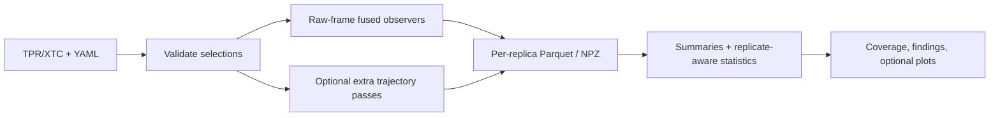
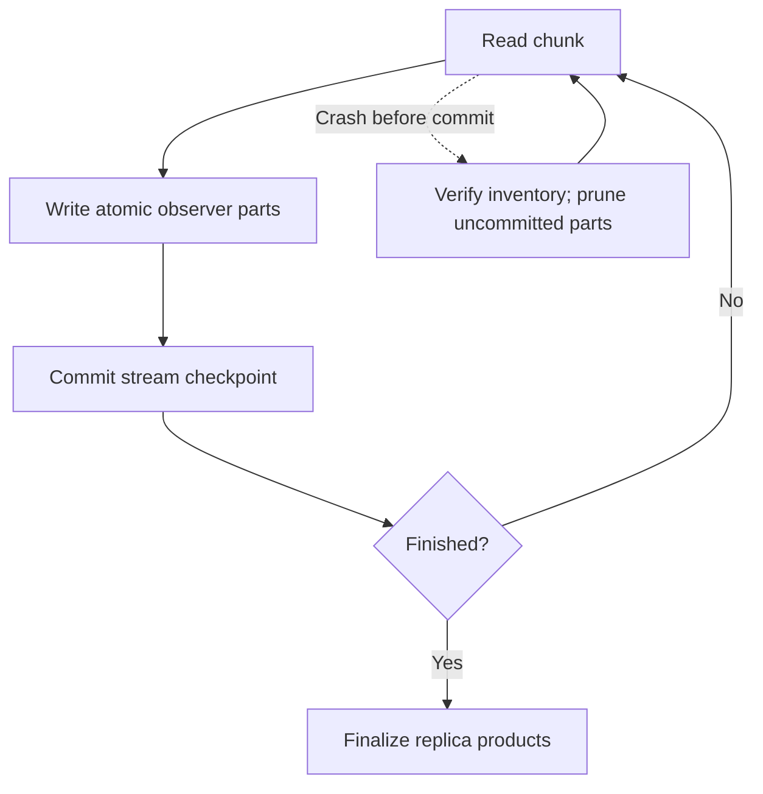

# Workflows and saved results

## Run a full SDC4 analysis

`synd4_full_mechanisms.yaml` configures two membrane conditions and **six replicas**; its output directory is separate from `synd4_baseline.yaml`.

```bash
python -m pip install -e '.[sasa]'
mdscope validate synd4_full_mechanisms.yaml
mdscope run synd4_full_mechanisms.yaml

# On an array/HPC run, process replicas first; then:
mdscope finalize synd4_full_mechanisms.yaml

# Recalculate from saved replica outputs, no XTC reread:
mdscope statistics synd4_full_mechanisms.yaml
mdscope plotting synd4_full_mechanisms.yaml
```

Use `run_mdscope.sh`, `statistics_mdscope.sh`, `plotting_mdscope.sh` and `finalize_mdscope.sh` with your validated YAML on Slurm. `run` performs replica processing **and** numerical finalization; `replicate --index N` processes one replica without project finalization.

The statistics job reports its current stage and elapsed time in `slurm-out/mdscope/mdscope_statistics-<jobid>.out`. Long stages print a heartbeat every minute. Set `progress.enabled: false` to suppress progress messages.

## Selective time-series and interaction inference (issue #179)

Existing YAML without `statistics.metric_selection` retains all enabled
family-level inference. An explicit `time_series: []` computes **no**
time-series inference, even when raw RMSD, lipid and membrane analyses remain
enabled. Match the persisted `(group, metric)` identity exactly:

```yaml
statistics:
  metric_selection:
    time_series:
      - {group: PROA, metric: rmsd_A}
      - {metric: membrane_thickness_A}
      - {group: lipid_contacts/upper/DOPC/GM1a, metric: enrichment}
```

Omit `group` for the ungrouped summary series. The lipid-contact group uses
the exact saved `lipid_contacts/<leaflet>/<species_a>/<species_b>` identity.
`mdscope plan` reports the requested identities and marks dynamic identities
as saved-data-dependent. Interaction inference uses the **canonical saved** label built from
`interaction_key_columns`, not a new ID. Select an entire interaction kind,
one exact identity, or one metric on that identity:

```yaml
statistics:
  metric_selection:
    interactions:
      - {kind: salt_bridges, interaction: "PROA:ASP12 | PROB:LYS7 | interchain", metric: occupancy}
      - {kind: lipid_hydrogen_bonds, metric: event_rate_per_ns}
```

The interaction string shown is illustrative, **not** a guaranteed identity
for any saved dataset. Allowed metrics are `occupancy`,
`event_rate_per_ns`, `mean_lifetime_ps`, `median_lifetime_ps` and
`total_lifetime_ps`. Omitting `interaction` means all identities of that
kind; omitting `metric` selects all five metrics. An explicit
`interactions: []` computes no interaction statistics. Missing saved
identities fail before statistical outputs are written. The existing
`interaction_min_occupancy` filter still applies to selected identities.

The same optional `metric_selection` contract now supports all statistics
families. Each selector uses the scientific identity actually persisted by its
writer; no inferred residue/site IDs or RDF-bin pseudo-replicates are created:

```yaml
statistics:
  metric_selection:
    profiles:
      - {profile: rmsf}
    solvation_rdfs:
      - {solvent: water, target_class: protein, site_class: carboxylate}
    diffusion:
      - {metric: DOPC}
    coupling:
      - {mechanism: membrane_coupling}
```

Profile names and diffusion metric strings above are illustrative: check the
saved outputs or `mdscope plan` and use the exact names in your data. An
empty list for any family disables that family's statistical work. Every
selected metric defaults to `inference: true`; set `inference: false`
to retain descriptive point estimates without computing block-bootstrap or
hierarchical CIs, permutation p-values, or other inferential contrasts:

```yaml
statistics:
  metric_selection:
    time_series:
      - {group: PROA, metric: rmsd_A, inference: true}
      - {metric: membrane_thickness_A, inference: false}
    interactions:
      - {kind: salt_bridges, metric: occupancy, inference: false}
plots:
  # Statistical figures are independently controlled by explicit plot IDs.
  include:
    - "time_series:rmsd_A:bootstrap_table"
```

An inference-disabled metric cannot produce a valid interval or p-value;
columns retained for output compatibility are null, with zero bootstrap draws.
The `inference` flag is shorthand for both estimators. To request only
one, set `ci` and `hypothesis_tests` independently on a selected time-series,
profile or interaction metric:

```yaml
statistics:
  metric_selection:
    time_series:
      - {group: PROA, metric: rmsd_A, ci: true, hypothesis_tests: false}
      - {metric: membrane_thickness_A, ci: false, hypothesis_tests: true}
```

The first produces point summaries and bootstrap CIs without permutation
tests or q-values. The second produces point summaries and permutation
tests without bootstrap CIs. RDF, diffusion and coupling writers support
`ci` (replica or first-shell contrasts), but **not**
`hypothesis_tests`; unsupported requests fail YAML validation. A
contradictory `inference: false, ci: true` is invalid. Omitted
`inference` and estimator flags preserve the original calculation.

For whole-curve RDF selectors, `inference: false` retains descriptive
g(r) and replicate dispersion but disables first-shell contrasts. For
diffusion and coupling it retains per-replica estimates without
between-condition inferential contrasts. Missing selectors preserve the
original numerical behavior. Unknown
saved identities are rejected before numerical outputs are written. RDF
selection includes all radial bins for the selected chemical class, preserving
shell integration and replica-level inference; diffusion selection includes
its full lag grid. Coupling names are checked against configured pairs.
Raw analyses and `plots.include` remain independently controlled.

`mdscope plan` exposes each family's identity fields, supported estimators,
conditional output paths and figure-ID patterns. After a completed
statistics run, `mdscope.planning.inspect_saved_statistics(output_root)`
provides the **actual** Parquet column schemas and saved metric identities
in a read-only, bounded catalog (`max_identities` defaults to 256;
`identities_truncated` flags incomplete identity lists). This is intended
for Studio's data-backed metric card; it does not open trajectories.
 Most concrete identities
are **saved-data-dependent**; the plan does not fabricate them.

Selections filter before temporal bootstrap/CI/permutation calculations and
avoid reading irrelevant top-level saved source tables where possible.
Interaction selection skips unrelated kinds and interaction identities before
the expensive per-identity loop. Selective inference uses identity-keyed
Monte Carlo streams so changing the selection does not shift existing selected
identities' bootstrap and permutation results. **BH q-values may change**
when the selected hypothesis family changes; this is mathematically required,
not RNG instability. The legacy no-selector RNG sequence remains unchanged. For a selected identity, the shared temporal
bootstrap kernel still prepares all five summary arrays; unselected metrics
skip CI, hierarchy, comparisons, and persistence. This is not yet full
metric-specific kernel factorization (see #156).
Statistical products are regenerated with the existing archive/manifest
contract; previous results are not silently reused after selection changes.

## Data flow



| Stage | Operations | Extra XTC pass? |
|---|---|---|
| Shared source loop | RMSD/RMSF/Rg, bilayer geometry/APL/MSD, lipid order/normals/enrichment, density, contacts, H bonds, serial DSSP, SASA, SDC4, residue distances | No extra pass for enabled fused observers |
| Optional/specialized | Multi-origin MSD, potassium bridge audit, some DSSP backends | **Yes**, independently restartable |
| `summarize_replicate` | Merge framewise output; compute profiles and interaction derivatives | No |
| `statistics`/`finalize` | Replica/bootstrap comparisons, RDF/diffusion/coupling, shared states, coverage and findings | No |
| `plotting`/`report` | Render saved tables and figures | No |

**Source frames remain unrotated by protein fitting.** Protein H bonds/DSSP reuse MDAnalysis private `_single_frame` interfaces: rerun real-data parity tests after MDAnalysis upgrades. Per-leaflet lipid order fixes initial cohorts; normals/enrichment recalculate leaflets. See [Scientific contracts](developer/scientific-contracts.md).

## Restart and file retention



- Parts: `<replica>/cache/fused_{membrane,extensions,distance}/`, with numbered Parquet/NPZ files.
- Committed parts are validated by identity, metadata/inventory and required companion files; incomplete or corrupt products fail safely.
- Only **uncommitted** parts are pruned/replayed. Keep restart caches until the stream completion marker is written.
- `fused_*_timings.json` and `stage_timings.json` record where time is spent.
- Numerical reruns archive prior results in `.archives/`; archives can consume disk. Do not treat a completed marker alone as scientific validation.

## SDC4 topology checkpoints

The original release TPRs contain **three attached HS chains per protomer**:

| Protein | Covalent serine OG attachments |
|---|---|
| PROA | S39, S61, S63 |
| PROB | S309, S331, S333 |

`hs_auto` follows **covalent glycan components**, not `chainID`; HS sugars share PROA/PROB IDs with their protein. Rebuilt topologies need a new attachment audit.

Before production, check selections for water/ions, NxIP, GGIVG, lipid anchors, six HS chains and valid analysis frames. In the older topology, GGIVG was found in PROA, not PROB; a missing motif must not become a measured zero.

The full SDC4 workflow includes protein/TM geometry, HS hydration/contact/ion measures, lipid organization and maps, isolated/environment SASA, water/ion RDFs, bridge evidence, multi-origin MSD and replica-level statistics. The **complete enabled list and atom selectors live in the YAML**, not here.

- Membrane-relative density: phospholipid phosphate midplane, equal leaflet weight, ±100 Å fixed grid for SDC4; follows translation, **not** tilt/undulation.
- Local thickness/curvature: use comparable phospholipid anchors and supported planar geometry.
- Environment SASA: ensure the whole target is appropriately imaged and clear of periodic faces.
- New lipid footprint/residue hydration/HS sugar outputs can require a **new trajectory pass for missing products**; re-finalize statistics afterwards.

## Find and interpret results

| Path under `project.output` | Read it for |
|---|---|
| `<system>/<replica>/summary/` | Scalar metrics, diffusion and per-replica summaries |
| `<system>/<replica>/profiles/` | RMSF, density, SASA, membrane order, residue distances |
| `<system>/<replica>/interactions/` | Events, occupancy, residence/lifetimes |
| `<system>/<replica>/extensions/` | Solvation, lipid neighbors/footprint, SDC4/HS and K audits |
| `project_summary/statistics/findings.md` | Fast review of valid interval exclusions and coverage |
| `statistics/findings.parquet` | Exact finite contrasts excluding zero (exploratory until multiplicity checked) |
| `statistics/coverage/contrast_coverage.parquet` | All registered comparisons, including unavailable status |
| `statistics/output_inventory.parquet` | Saved products and Parquet row counts |
| `project_summary/shared_states/` | Model, frame assignments and replica populations |

```bash
mdscope report /path/to/project_summary/statistics
mdscope scan-residue-regions /path/to/project_summary/statistics
```

- Region scan: ≥3 consecutive residues on the same chain, finite in **every** expected replica, with nonoverlapping replica ranges and consistent direction; requires ≥2 replicas per condition. It is exploratory, **not** a simultaneous CI.
- RDF-shell contrasts average saved curves using shell volumes; multi-origin diffusion contrasts refit shared supported lag windows. Require complete replica coverage.
- Matched scalar windows: `statistics.matched_window_ps: auto` or `[start,stop]`. Coupling requires a common regular grid. HS episodes retain censoring.
- Relative membrane position and lipid density maps have distinct reference/area conventions; do not infer binding affinity from proximity.
- Three independent replicas per condition give limited permutation resolution; inspect temporal stability and each replicate before interpreting biological contrasts.

[Configuration](configuration.md) · [Analysis definitions](analyses.md) · [Scientific audit](developer/scientific-audit.md)
