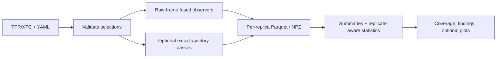
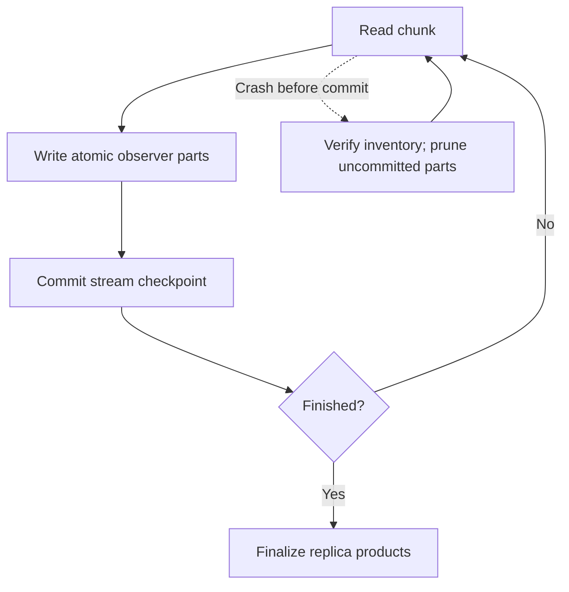

# Workflows and saved results

## Run a full SDC4 analysis

`synd4_full_mechanisms.yaml` configures two membrane conditions and **six replicas**; its output directory is separate from `synd4_baseline.yaml`.

```bash
python -m pip install -e '.[sasa]'
mdscope validate synd4_full_mechanisms.yaml
mdscope run synd4_full_mechanisms.yaml

# On an array/HPC run, process replicas first; then:
mdscope finalize synd4_full_mechanisms.yaml

# Recalculate from saved replica outputs, no XTC reread:
mdscope statistics synd4_full_mechanisms.yaml
mdscope plotting synd4_full_mechanisms.yaml
```

`run` performs replica processing **and** numerical finalization; `replicate --index N` processes one replica without project finalization.

## Environment variables

All variables read by MDscope source code or shipped runner scripts are listed
here. YAML remains the primary interface for scientific settings; these
variables control logging, environment setup, resource use and test tooling.

| Variable | Reader | Default when unset | Effect |
|---|---|---|---|
| `MDSCOPE_DEBUG` | CLI | Disabled | `1` re-raises expected user-input errors with traceback |
| `MDSCOPE_PROGRESS_EVERY_PERCENT` | `core/progress.py`, Slurm replicate runner | `1` | Percentage steps for progress when total work is known |
| `MDSCOPE_PROGRESS_EVERY_FRAMES` | `core/progress.py` | `25` | Frame steps for progress with unknown total |
| `MDSCOPE_PROFILE` | `core/profiling.py`, interaction statistics; Slurm and real-data scripts | Off in Python; `1` in replicate/real-data scripts | Collect wall-time profiling data |
| `MDSCOPE_STATS_WORKERS` | `statistics/common.py`, statistics Slurm script | `SLURM_CPUS_PER_TASK` when available; otherwise module default | Worker count for supported statistics operations |
| `MDSCOPE_ORDER_FINALIZE_MEMORY_MB` | `pipeline/fused_membrane.py` | `256` | Memory budget (MiB) for lipid-order finalization |
| `MDSCOPE_ENV_SETUP` | `slurm/job_env.sh` | ARC example Miniconda `mdanalysis` environment | Path to a shell setup script; `none` uses inherited environment |
| `MDSCOPE_REAL_DATA` | `scripts/run_real_data_checks.sh` | `examples/data` | Real test-data directory |
| `MDSCOPE_REAL_OUTPUT` | `scripts/run_real_data_checks.sh` | `real_test_results` | Destination for real-data checks |
| `MDSCOPE_HBOND_BENCH_FRAMES` | Real-data H-bond benchmark via `scripts/run_real_data_checks.sh` | `8` | H-bond benchmark frame count |
| `MDSCOPE_BOX_FRAMES` | `scripts/run_real_data_checks.sh` | `40` (box sweep), `200` (clearance) | Frame cap for optional box-geometry checks |
| `PYTHONUNBUFFERED` | Slurm and real-data shell scripts / Python runtime | `1` in scripts | Flush Python log output promptly |

`SLURM_CPUS_PER_TASK` and `SLURM_ARRAY_TASK_*` are scheduler-provided
settings, not MDscope-specific environment variables.

## Slurm jobs

Submit `slurm/run_mdscope.sh`, `slurm/finalize_mdscope.sh`, `slurm/statistics_mdscope.sh` and `slurm/plotting_mdscope.sh` from the MDscope checkout (they source `slurm/job_env.sh`) with your validated YAML. Jobs **never install** MDscope: install it once, before submitting, into the environment the jobs activate (`python -m pip install -e '.[sasa]'`). Each job first checks that `python` imports MDscope, logs its version, source directory and commit, and otherwise exits with setup instructions.

| Setting | ARC example (script default) | Other sites |
|---|---|---|
| Account, partition | `#SBATCH -A bevanlab`, `-p normal_q` | `sbatch -A ACCOUNT -p PARTITION ...`; command-line flags override `#SBATCH` lines |
| Environment | Miniconda env `mdanalysis` | `MDSCOPE_ENV_SETUP=/path/setup.sh` (bash file sourced by the job) or `MDSCOPE_ENV_SETUP=none` (keep the environment exported by `sbatch`) |
| Replica array | `--array=0-5` (six replicas of `synd4_full_mechanisms.yaml`) | `--array=0-<N-1>`, N from the schema-only plan |

`slurm/run_mdscope.sh` runs one task per YAML replicate, indexed in plan order; the plan reads no topology or trajectory:

```bash
N=$(mdscope plan CONFIG.yaml --format json | python -c 'import json,sys; print(len(json.load(sys.stdin)["replicates"]))')
sbatch -A ACCOUNT -p PARTITION --array=0-$((N-1)) slurm/run_mdscope.sh CONFIG.yaml
```

Every task repeats this derivation and exits before analysis, printing the expected `--array` range, unless the submitted array is exactly `0..N-1` (`SLURM_ARRAY_TASK_MIN/MAX/COUNT`). Reprocess one failed replica with `mdscope replicate CONFIG.yaml --index I` in its own job, not with a partial array.

The statistics job reports its current stage and elapsed time in `slurm-out/mdscope/mdscope_statistics-<jobid>.out`. Long stages print a heartbeat every minute. Set `progress.enabled: false` to suppress progress messages.

## Selective statistics

Use exact **saved** metric identities. Omitting `statistics.metric_selection`
preserves legacy inference; a family set to `[]` skips its statistics without
disabling raw analyses.

```yaml
statistics:
  metric_selection:
    time_series:
      - {group: PROA, metric: rmsd_A, ci: true, hypothesis_tests: false}
      - {metric: membrane_thickness_A, inference: false}
    interactions:
      - {kind: salt_bridges, metric: occupancy}
    profiles:
      - {profile: rmsf}
    solvation_rdfs:
      - {solvent: water, target_class: protein, site_class: acidic}
    diffusion:
      - {metric: DOPC}
    coupling:
      - {mechanism: membrane_coupling}
plots:
  include: ["time_series:rmsd_A:bootstrap_table"]
```

| Family | Identity | Selectable inference |
|---|---|---|
| `time_series` | `group`, `metric` | CI, hypothesis tests |
| `interactions` | `kind`, optional `interaction`, optional `metric` | CI, hypothesis tests |
| `profiles` | `profile` | CI, hypothesis tests |
| `solvation_rdfs` | `solvent`, `target_class`, `site_class` | Shell contrast |
| `diffusion` | `metric` | Replicate contrast |
| `coupling` | `mechanism` | Replicate contrast |
| `lipid_contacts` | `level`, `leaflet`, `species_a`, `species_b`, `metric` | CI |

Selectors default to `inference: true`. Use `inference: false` for
descriptive-only statistics; for the first three families, `ci` and
`hypothesis_tests` can be toggled separately. Unsupported estimator
combinations fail validation. All requested identities must exist in saved
data; example IDs above are illustrative. An omitted interaction identity
selects every identity of that kind, and an omitted interaction metric
selects all five supported interaction statistics. The existing occupancy
threshold still applies.

`mdscope plan` exposes analysis/run candidates, identity fields, estimator
eligibility, conditional files, and figure-ID patterns without reading XTCs.
For completed outputs, `mdscope.planning.inspect_saved_statistics(root)`
reads actual Parquet schemas and saved IDs with a bounded identity limit.
Dynamic IDs are never invented.

Raw analyses, metric inference, and `plots.include` are independently
controlled. CIs and p/q-values are null when inference is disabled; paired
design and replica-level uncertainty rules are unchanged. Selective
Monte Carlo streams are identity-stable; BH q-values may change when the
hypothesis family changes. Statistics reruns archive previous products.

## Data flow



| Stage | Operations | Extra XTC pass? |
|---|---|---|
| Shared source loop | RMSD/RMSF/Rg, bilayer geometry/APL/MSD, lipid order/normals/enrichment, density, contacts, H bonds, serial DSSP, SASA, SDC4, residue distances | No extra pass for enabled fused observers |
| Optional/specialized | Multi-origin MSD, potassium bridge audit, some DSSP backends | **Yes**, independently restartable |
| `summarize_replicate` | Merge framewise output; compute profiles and interaction derivatives | No |
| `statistics`/`finalize` | Replica/bootstrap comparisons, RDF/diffusion/coupling, shared states, coverage and findings | No |
| `plotting`/`report` | Render saved tables and figures | No |

**Source frames remain unrotated by protein fitting.** Protein H bonds/DSSP reuse MDAnalysis private `_single_frame` interfaces: rerun real-data parity tests after MDAnalysis upgrades. Per-leaflet lipid order fixes initial cohorts; normals/enrichment recalculate leaflets. See [Scientific contracts](developer/scientific-contracts.md).

## Restart and file retention



- Parts: `<replica>/cache/fused_{membrane,extensions,distance}/`, with numbered Parquet/NPZ files.
- Committed parts are validated by identity, metadata/inventory and required companion files; incomplete or corrupt products fail safely.
- Only **uncommitted** parts are pruned/replayed. Keep restart caches until the stream completion marker is written.
- `fused_*_timings.json` and `stage_timings.json` record where time is spent.
- Numerical reruns archive prior results in `.archives/`; archives can consume disk. Do not treat a completed marker alone as scientific validation.

## SDC4 topology checkpoints

HS attachments, `hs_auto` and motif availability for the release topologies are described under [Release topology](analyses.md#syndecan-4-sdc4-mechanisms); rebuilt topologies need a new attachment audit.

Before production, check selections for water/ions, NxIP, GGIVG, lipid anchors, six HS chains and valid analysis frames. In the older topology, GGIVG was found in PROA, not PROB; a missing motif must not become a measured zero.

The full SDC4 workflow includes protein/TM geometry, HS hydration/contact/ion measures, lipid organization and maps, isolated/environment SASA, water/ion RDFs, bridge evidence, multi-origin MSD and replica-level statistics. The **complete enabled list and atom selectors live in the YAML**, not here.

- Membrane-relative density: phospholipid phosphate midplane, equal leaflet weight, ±100 Å fixed grid for SDC4; follows translation, **not** tilt/undulation.
- Local thickness/curvature: use comparable phospholipid anchors and supported planar geometry.
- Environment SASA: ensure the whole target is appropriately imaged and clear of periodic faces.
- Enabling a new fused output (for example lipid footprint or residue/HS hydration) on a completed project replays only the missing outputs, all in one trajectory pass; completed products are not rewritten. Re-finalize statistics afterwards.

## Find and interpret results

| Path under `project.output` | Read it for |
|---|---|
| `<system>/<replica>/summary/` | Scalar metrics, diffusion and per-replica summaries |
| `<system>/<replica>/profiles/` | RMSF, density, SASA, membrane order, residue distances |
| `<system>/<replica>/interactions/` | Events, occupancy, residence/lifetimes |
| `<system>/<replica>/extensions/` | Solvation, lipid neighbors/footprint, SDC4/HS and K audits |
| `project_summary/statistics/findings.md` | Fast review of valid interval exclusions and coverage |
| `statistics/findings.parquet` | Exact finite contrasts excluding zero (exploratory until multiplicity checked) |
| `statistics/coverage/contrast_coverage.parquet` | All registered comparisons, including unavailable status |
| `statistics/output_inventory.parquet` | Saved products and Parquet row counts |
| `project_summary/shared_states/` | Model, frame assignments and replica populations |

```bash
mdscope report /path/to/project_summary/statistics
mdscope scan-residue-regions /path/to/project_summary/statistics
```

- Region scan: ≥3 consecutive residues on the same chain, finite in **every** expected replica, with nonoverlapping replica ranges and consistent direction; requires ≥2 replicas per condition. It is exploratory, **not** a simultaneous CI.
- RDF-shell contrasts average saved curves using shell volumes; multi-origin diffusion contrasts refit shared supported lag windows. Require complete replica coverage.
- Matched scalar windows: `statistics.matched_window_ps: auto` or `[start,stop]`. Coupling requires a common regular grid. HS episodes retain censoring.
- Relative membrane position and lipid density maps have distinct reference/area conventions; do not infer binding affinity from proximity.
- Three independent replicas per condition give limited permutation resolution; inspect temporal stability and each replicate before interpreting biological contrasts.

## Recompute statistics and figures without rereading trajectories

When replica products are complete, statistics, residue-response regions, lipid-contact matrices and figures are recomputed from saved data only:

```bash
mdscope statistics analysis.yaml            # archives the previous statistics export first
mdscope plotting analysis.yaml
mdscope scan-residue-regions RESULTS/project_summary/statistics   # residue-response tables from a complete export
mdscope statistics analysis.yaml --results-dir PATH   # finalize results stored elsewhere
```

Changing `analyses.lipid_contacts.classes` or `statistics.residue_response` settings affects only these offline products, not the per-frame observers. Rerun the replica pipeline only for genuinely missing measurement products. Definitions of these products: [Analyses](analyses.md#residue-response-heatmap) and [lipid contacts](analyses.md#lipid-contact-classes-and-statistics).

[Configuration](configuration.md) · [Analysis definitions](analyses.md) · [Scientific audit](developer/scientific-audit.md)
