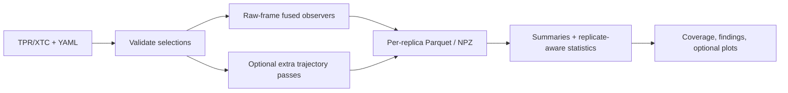
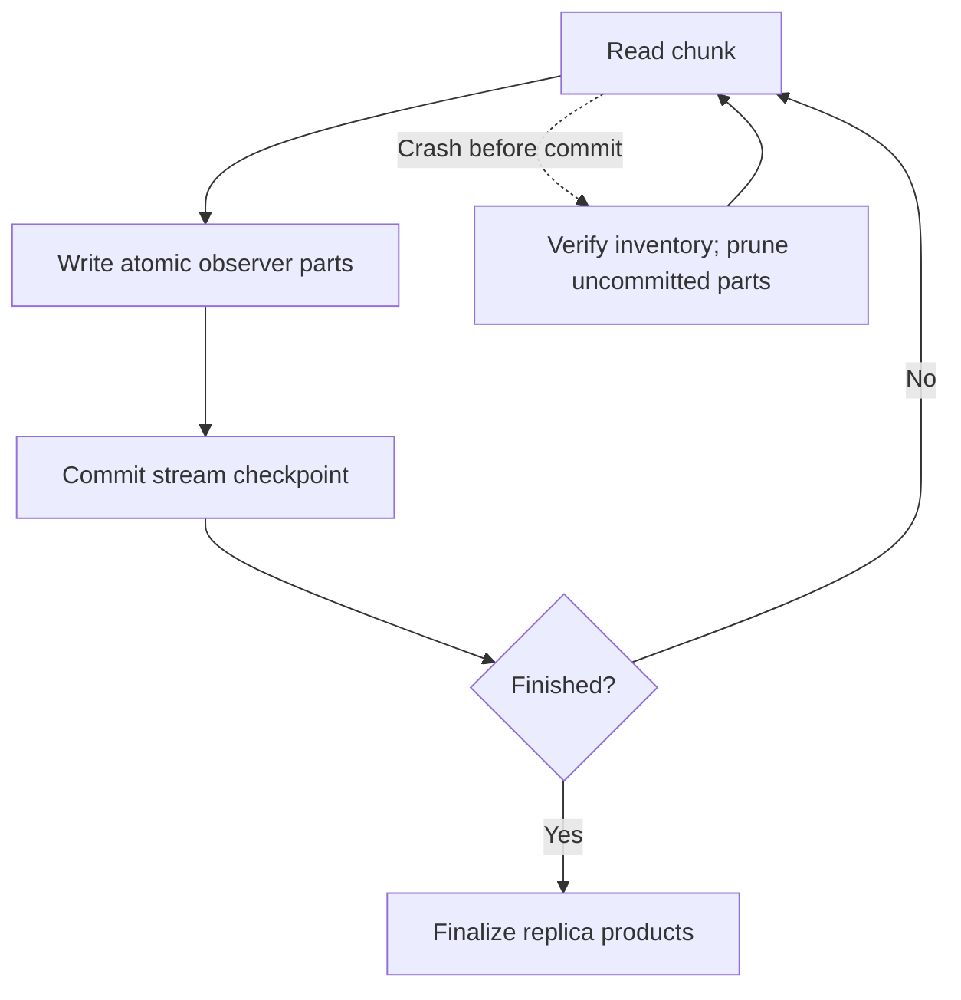

# Workflows and saved results

## Run a full SDC4 analysis

`synd4_full_mechanisms.yaml` configures two membrane conditions and **six replicas**; its output directory is separate from `synd4_baseline.yaml`.

```bash
python -m pip install -e '.[sasa]'
mdscope validate synd4_full_mechanisms.yaml
mdscope run synd4_full_mechanisms.yaml

# On an array/HPC run, process replicas first; then:
mdscope finalize synd4_full_mechanisms.yaml

# Recalculate from saved replica outputs, no XTC reread:
mdscope statistics synd4_full_mechanisms.yaml
mdscope plotting synd4_full_mechanisms.yaml
```

Use `run_mdscope.sh`, `statistics_mdscope.sh`, `plotting_mdscope.sh` and `finalize_mdscope.sh` with your validated YAML on Slurm. `run` performs replica processing **and** numerical finalization; `replicate --index N` processes one replica without project finalization.

The statistics job reports its current stage and elapsed time in `slurm-out/mdscope/mdscope_statistics-<jobid>.out`. Long stages print a heartbeat every minute. Set `progress.enabled: false` to suppress progress messages.

## Data flow



| Stage | Operations | Extra XTC pass? |
|---|---|---|
| Shared source loop | RMSD/RMSF/Rg, bilayer geometry/APL/MSD, lipid order/normals/enrichment, density, contacts, H bonds, serial DSSP, SASA, SDC4, residue distances | No extra pass for enabled fused observers |
| Optional/specialized | Multi-origin MSD, potassium bridge audit, some DSSP backends | **Yes**, independently restartable |
| `summarize_replicate` | Merge framewise output; compute profiles and interaction derivatives | No |
| `statistics`/`finalize` | Replica/bootstrap comparisons, RDF/diffusion/coupling, shared states, coverage and findings | No |
| `plotting`/`report` | Render saved tables and figures | No |

**Source frames remain unrotated by protein fitting.** Protein H bonds/DSSP reuse MDAnalysis private `_single_frame` interfaces: rerun real-data parity tests after MDAnalysis upgrades. Per-leaflet lipid order fixes initial cohorts; normals/enrichment recalculate leaflets. See [Scientific contracts](developer/scientific-contracts.md).

## Restart and file retention



- Parts: `<replica>/cache/fused_{membrane,extensions,distance}/`, with numbered Parquet/NPZ files.
- Committed parts are validated by identity, metadata/inventory and required companion files; incomplete or corrupt products fail safely.
- Only **uncommitted** parts are pruned/replayed. Keep restart caches until the stream completion marker is written.
- `fused_*_timings.json` and `stage_timings.json` record where time is spent.
- Numerical reruns archive prior results in `.archives/`; archives can consume disk. Do not treat a completed marker alone as scientific validation.

## SDC4 topology checkpoints

The original release TPRs contain **three attached HS chains per protomer**:

| Protein | Covalent serine OG attachments |
|---|---|
| PROA | S39, S61, S63 |
| PROB | S309, S331, S333 |

`hs_auto` follows **covalent glycan components**, not `chainID`; HS sugars share PROA/PROB IDs with their protein. Rebuilt topologies need a new attachment audit.

Before production, check selections for water/ions, NxIP, GGIVG, lipid anchors, six HS chains and valid analysis frames. In the older topology, GGIVG was found in PROA, not PROB; a missing motif must not become a measured zero.

The full SDC4 workflow includes protein/TM geometry, HS hydration/contact/ion measures, lipid organization and maps, isolated/environment SASA, water/ion RDFs, bridge evidence, multi-origin MSD and replica-level statistics. The **complete enabled list and atom selectors live in the YAML**, not here.

- Membrane-relative density: phospholipid phosphate midplane, equal leaflet weight, ±100 Å fixed grid for SDC4; follows translation, **not** tilt/undulation.
- Local thickness/curvature: use comparable phospholipid anchors and supported planar geometry.
- Environment SASA: ensure the whole target is appropriately imaged and clear of periodic faces.
- New lipid footprint/residue hydration/HS sugar outputs can require a **new trajectory pass for missing products**; re-finalize statistics afterwards.

## Find and interpret results

| Path under `project.output` | Read it for |
|---|---|
| `<system>/<replica>/summary/` | Scalar metrics, diffusion and per-replica summaries |
| `<system>/<replica>/profiles/` | RMSF, density, SASA, membrane order, residue distances |
| `<system>/<replica>/interactions/` | Events, occupancy, residence/lifetimes |
| `<system>/<replica>/extensions/` | Solvation, lipid neighbors/footprint, SDC4/HS and K audits |
| `project_summary/statistics/findings.md` | Fast review of valid interval exclusions and coverage |
| `statistics/findings.parquet` | Exact finite contrasts excluding zero (exploratory until multiplicity checked) |
| `statistics/coverage/contrast_coverage.parquet` | All registered comparisons, including unavailable status |
| `statistics/output_inventory.parquet` | Saved products and Parquet row counts |
| `project_summary/shared_states/` | Model, frame assignments and replica populations |

```bash
mdscope report /path/to/project_summary/statistics
mdscope scan-residue-regions /path/to/project_summary/statistics
```

- Region scan: ≥3 consecutive residues on the same chain, finite in **every** expected replica, with nonoverlapping replica ranges and consistent direction; requires ≥2 replicas per condition. It is exploratory, **not** a simultaneous CI.
- RDF-shell contrasts average saved curves using shell volumes; multi-origin diffusion contrasts refit shared supported lag windows. Require complete replica coverage.
- Matched scalar windows: `statistics.matched_window_ps: auto` or `[start,stop]`. Coupling requires a common regular grid. HS episodes retain censoring.
- Relative membrane position and lipid density maps have distinct reference/area conventions; do not infer binding affinity from proximity.
- Three independent replicas per condition give limited permutation resolution; inspect temporal stability and each replicate before interpreting biological contrasts.

[Configuration](configuration.md) · [Analysis definitions](analyses.md) · [Scientific audit](developer/scientific-audit.md)
